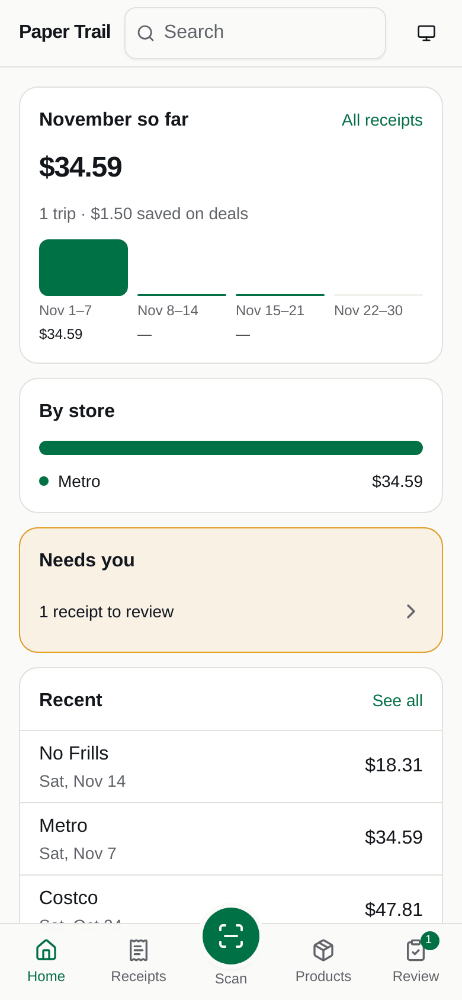
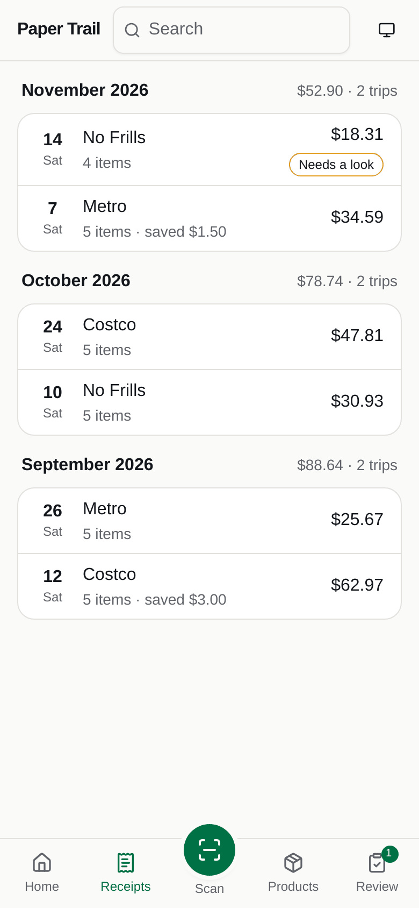
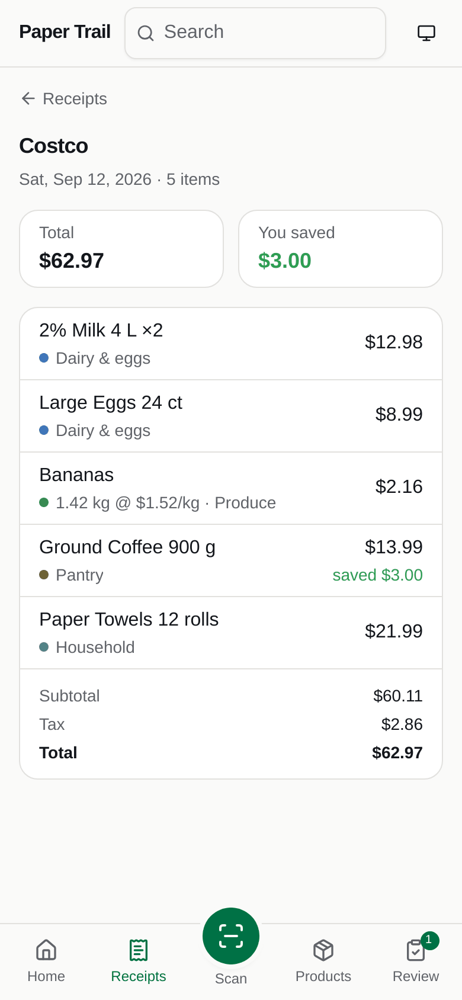
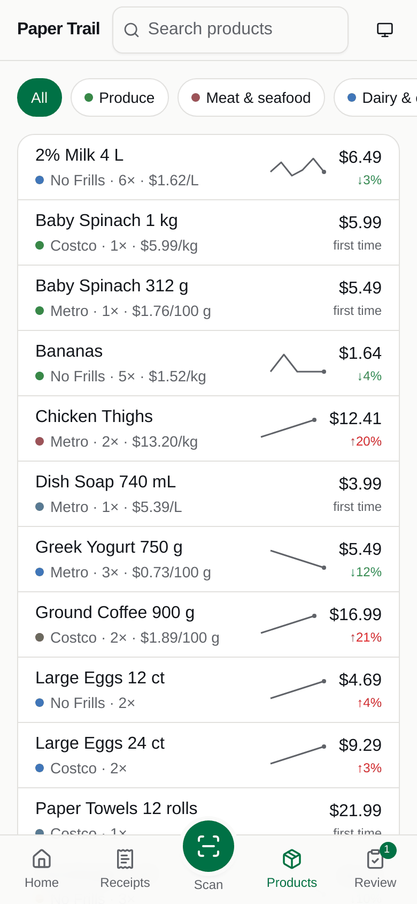
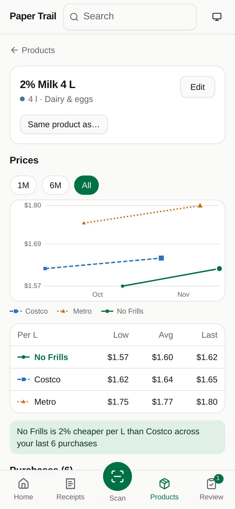
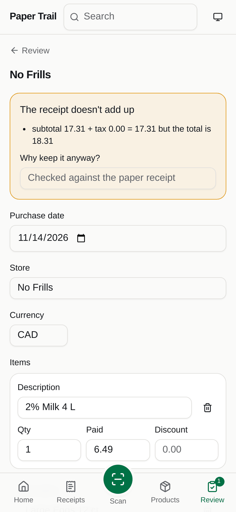
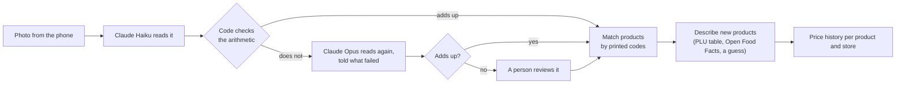

# Paper Trail

Paper Trail turns photos of receipts into a searchable record of what you bought, where, and at
what price, with a price history for every item. A small team of agents (extraction, validation,
product matching, enrichment) built with LangGraph processes each receipt: Claude reads the
photo item by item, code checks that every number adds up, and a second, stronger Claude model
reads it again when it does not. It is a FastAPI + React app that runs in Docker on a home
server; the database and your photos stay on that server, and each photo is sent to Anthropic
to be read (see [Privacy](#privacy)).

The phone web app is the main way in: scan a receipt, fix the ones that need a person, browse
receipts and products, and follow each product's price across stores. A CLI and an MCP server
reach the same agents and tools for batch runs and experiments. What is planned next is in
[`docs/ROADMAP.md`](docs/ROADMAP.md).

<table>
  <tr>
    <td></td>
    <td></td>
    <td></td>
  </tr>
  <tr>
    <td align="center">Home</td>
    <td align="center">Receipts</td>
    <td align="center">A receipt</td>
  </tr>
  <tr>
    <td></td>
    <td></td>
    <td></td>
  </tr>
  <tr>
    <td align="center">Products</td>
    <td align="center">Price tracker</td>
    <td align="center">Review</td>
  </tr>
</table>

The screenshots show made-up demo receipts ([`docs/screenshots/demo`](docs/screenshots/demo/)).

## How it works



1. You send a photo from the phone; the `worker` reads it in the background.
2. Claude transcribes every line as printed. It never does the maths: Python adds the lines up
   and checks them against the subtotal, tax and total.
3. A receipt that does not add up is read again by a stronger model, told what failed. If it
   still does not add up, it waits in the Review tab for you.
4. Each line is matched to a product by the code printed on it (a barcode, a PLU, a store's item
   number), without asking a model; new products are described from open product databases, or
   guessed and marked for you to confirm.
5. Every purchase adds a price observation, so each product has a price history per store.

The details, from the architecture to the database tables, are in
[How it works](docs/how-it-works.md).

## Set up

### Prerequisites

- **Docker** with Docker Compose v2 (Docker Engine on Linux, or Docker Desktop)
- **Make** and a POSIX shell (bash)
- **Git**
- An **Anthropic API key**, for reading receipt photos

That is all: everything else runs in containers, so nothing is installed on the host.

### Quick start

```sh
git clone <this repository> paper-trail && cd paper-trail
cp .env.example .env
# Edit .env: ANTHROPIC_API_KEY=<your key>
#            PAPER_TRAIL_BIND_ADDR=<the server's LAN address>, e.g. 192.168.1.10
#            PAPER_TRAIL_WEB__ALLOWED_HOSTS=<that address and the server's host name>
make build up
```

`make ps` shows `web` and `worker` as `healthy` once the stack is up. The key lives only in
`.env` (git-ignored); without it the app starts, and a receipt sent to the agents fails with a
message naming `ANTHROPIC_API_KEY` until it is set ([more on the key](docs/operations.md#the-api-key)).

### Open it on your phone

Open `http://<server LAN address>:8420` on your phone (over the LAN, or WireGuard when away;
see [Using the app](docs/using-the-app.md)).
Nothing listens on `0.0.0.0`: with the default `PAPER_TRAIL_BIND_ADDR=127.0.0.1` the app is
reachable only from the server itself at `http://127.0.0.1:8420`.

### Cost

Claude calls cost money: about $0.001 per receipt on the extract model and about $0.04 for a
retry on the retry model. `PAPER_TRAIL_CLAUDE__MONTHLY_BUDGET_USD` (default 5.00) caps the spend
per UTC calendar month; once it is reached, receipts fail and can be tried again after the cap is
raised or the month ends ([how the budget works](docs/operations.md#cost-and-the-monthly-budget)).

## Documentation

- [Using the app](docs/using-the-app.md): the screens, step by step, and the web API.
- [How it works](docs/how-it-works.md): architecture, the agents' graph, matching products,
  product lookups, what gets saved, tools and MCP.
- [The command line](docs/cli.md): importing receipts from JSON, processing photos with the
  agents, corrections and resuming, naming products by their codes.
- [Running and maintaining it](docs/operations.md): the API key and budget, Make targets,
  configuration, backups and restoring, upgrading.
- [Data and privacy](docs/privacy.md): what stays on your server and what is sent out.
- [All documentation](docs/README.md), including the design decisions (ADRs), roadmap and plans.

## Privacy

**There is no login.** The app is meant for your home network and WireGuard only; never publish
its port to the internet. **The whole photo of every receipt you process is sent to Anthropic**
to be read by Claude, so whatever the photo shows leaves your server: the card number as the
terminal printed it, a loyalty number, sometimes your name. Besides that, a new product's printed
text goes to Claude to have it described, and its barcode, alone, to Open Food Facts and its
sister databases. There is no telemetry.
Details in [Data and privacy](docs/privacy.md).

## Contributing

See [CONTRIBUTING.md](CONTRIBUTING.md) for the test strategy, layering rules and how to add a
migration.
