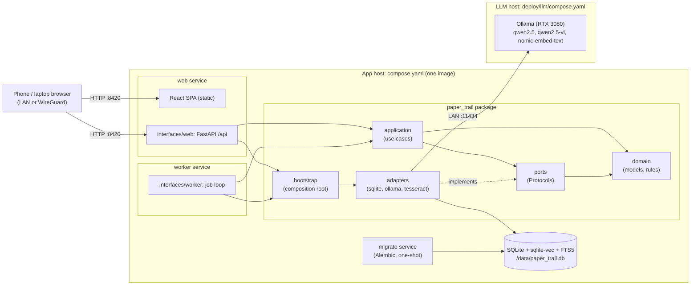
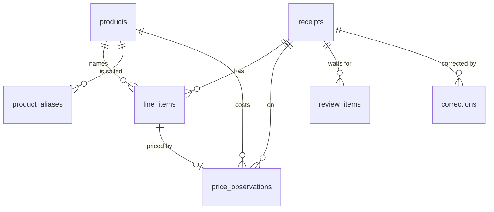

# Paper Trail

Paper Trail turns photos of receipts into a searchable record of what you bought, where, and at
what price, with a price history for every item. A small team of agents (extraction, validation,
product matching, enrichment) built with LangGraph reads each receipt through a local LLM served
by Ollama, so receipts, images and the database never leave your own hardware. It is a
FastAPI + React app that runs in Docker on a home server, with the model on a GPU PC on the same
network. Work is queued, so the GPU PC does not have to be on when you scan.

> Status: agent core slice D. Receipts can be imported from JSON, or read from photos by the
> agents from the command line (OCR, extraction by the local model, code-checked arithmetic with
> a feedback loop, the photo read by the vision model, review by a person), and browsed
> in the Receipts tab. Every agent calls its tools through a per-role allowlist, in-process or
> over MCP. Each line is matched to a product across stores (a person's correction, an exact
> alias, then embeddings, with the model confirming close calls), new products are described
> (name, size, category, tags), and a run can be paused and resumed from its checkpoint. The
> upload flow and the web pages for it arrive in the following stages (see
> [`docs/ROADMAP.md`](docs/ROADMAP.md) and [`docs/plans/agent-core.md`](docs/plans/agent-core.md)).

## Prerequisites

- **Docker** with Docker Compose v2 (Docker Engine on Linux, or Docker Desktop)
- **Make** and a POSIX shell (bash), on the app host and for development
- **Git**

That is all: everything else runs in containers, so nothing is installed on the host. A Windows
LLM host needs only Docker Desktop and Git: it runs plain `docker compose` commands, no Make.

## Quick start

Paper Trail has two roles, which can be two machines or one:

| Role | Runs | Compose file |
|---|---|---|
| **App host** (e.g. a home server) | `migrate`, `web` (API + web app), `worker` | `compose.yaml` |
| **LLM host** (a PC with an NVIDIA GPU) | `ollama`, `ollama-init` (pulls the models) | `deploy/llm/compose.yaml` |

### Two hosts: app server + GPU PC

On the **app host**:

```sh
git clone <this repository> paper-trail && cd paper-trail
cp .env.example .env
# Edit .env: PAPER_TRAIL_BIND_ADDR=<the server's LAN address>, e.g. 192.168.1.10
make build up
```

Open `http://<server LAN address>:8420` on your phone (over the LAN, or WireGuard when away).
`make ps` shows `web` and `worker` as `healthy` once the stack is up. Nothing listens on
`0.0.0.0`: with the default `PAPER_TRAIL_BIND_ADDR=127.0.0.1` the app is reachable only from the
server itself at `http://127.0.0.1:8420`.

On the **LLM host**, follow [LLM host (GPU PC)](#llm-host-gpu-pc) below, then point the app host at
it in `.env`: `PAPER_TRAIL_OLLAMA__BASE_URL=http://<GPU PC LAN address>:11434`.

### One GPU machine running everything

Both stacks run on the same Docker host and share a Docker network: the LLM stack's network is
named `paper-trail-llm`, and the overlay
[`deploy/single-host/compose.override.yaml`](deploy/single-host/compose.override.yaml) attaches
the app's `worker` to it, so the worker reaches Ollama by service name and no Ollama port has to
be reachable from outside the machine.

```sh
cp .env.example .env
cp deploy/llm/.env.example deploy/llm/.env   # keep OLLAMA_BIND_ADDR=127.0.0.1
cp deploy/single-host/compose.override.yaml compose.override.yaml
make llm-up        # Ollama + models; creates the paper-trail-llm network
make build up      # the app; its worker joins paper-trail-llm
```

The Makefile adds `compose.override.yaml` to every compose command when the file exists (it is
git-ignored, like `.env`). Start the LLM stack first: `make up` fails while the network is
missing. Set `PAPER_TRAIL_OLLAMA__BASE_URL=http://ollama:11434` in `.env`.

Do not point the worker at `http://host.docker.internal:11434` instead: on Linux that name
resolves to the Docker bridge gateway, where a port published on `127.0.0.1` is unreachable, and
publishing Ollama on a wider address only to make it work would expose an unauthenticated API.

## LLM host (GPU PC)

The model runs in Docker with GPU access, from `deploy/llm/compose.yaml`. The compose file is the
same on Windows and Linux.

### Windows 11 (Docker Desktop, WSL2)

1. Install the current **NVIDIA** Game Ready or Studio driver for your GPU. The driver brings GPU
   support to WSL2; no CUDA toolkit is needed on Windows or inside WSL.
2. Install **Docker Desktop** and keep the default **WSL2** backend (Settings, General, "Use the
   WSL 2 based engine"). Check GPU access with
   `docker run --rm --gpus all ubuntu nvidia-smi`.
3. Install Git (for example `winget install Git.Git`), clone this repository, then in
   PowerShell from the repository root:

   ```powershell
   copy deploy\llm\.env.example deploy\llm\.env
   # Edit deploy\llm\.env: OLLAMA_BIND_ADDR=<this PC's LAN address>
   docker compose -f deploy/llm/compose.yaml --env-file deploy/llm/.env up -d
   ```

   `ollama-init` pulls the three models (about 15 GB) once; they are kept in the `ollama-models`
   volume. Stop Ollama with
   `docker compose -f deploy/llm/compose.yaml --env-file deploy/llm/.env down` (the models are
   kept). No Make is needed on Windows: the Makefile expects bash, so `make llm-up` works only
   from WSL or Git Bash.
4. Ollama has no authentication, so port 11434 must accept connections **only from the app
   host**. An allow rule scoped to the app host is not enough on its own: Docker Desktop
   publishes ports through `com.docker.backend.exe`, and accepting Windows' first-run "allow
   access" prompt for it creates a program-wide inbound allow rule. Windows Firewall admits a
   connection if *any* allow rule matches, so that rule would open 11434 to the whole LAN. Block
   rules take precedence over allow rules, so add an allow rule for the app host **and** a block
   rule for every other address. In an administrator PowerShell (Windows Defender Firewall):

   ```powershell
   $AppHost = "192.168.1.10"   # your app host's LAN address
   New-NetFirewallRule -DisplayName "Ollama (Paper Trail app host only)" `
     -Direction Inbound -Protocol TCP -LocalPort 11434 `
     -RemoteAddress $AppHost -Action Allow -Profile Any
   # Every IPv4 address except the app host (here 192.168.1.10): adjust both ranges.
   New-NetFirewallRule -DisplayName "Ollama (block everyone else)" `
     -Direction Inbound -Protocol TCP -LocalPort 11434 `
     -RemoteAddress "0.0.0.0-192.168.1.9", "192.168.1.11-255.255.255.255" `
     -Action Block -Profile Any
   ```

   Then look for program-wide Docker rules and remove them, or at least make sure the block rule
   above exists:

   ```powershell
   Get-NetFirewallApplicationFilter -Program "*com.docker.backend*" |
     Get-NetFirewallRule | Where-Object { $_.Direction -eq "Inbound" -and $_.Action -eq "Allow" } |
     Format-Table DisplayName, Profile, Enabled
   ```

   Verify from both sides once Ollama is up: from the app host,
   `docker run --rm curlimages/curl:8.23.0 -s http://<GPU PC address>:11434/api/version` prints a
   version; from any other device on the LAN, for example another Windows PC,
   `Test-NetConnection <GPU PC address> -Port 11434` reports `TcpTestSucceeded : False`. Keep
   the network profile set to Private and do not forward the port on your router.

The PC does not have to stay on: the app host queues receipts and processes them when Ollama
answers again.

### Linux

Install the NVIDIA driver and the **NVIDIA Container Toolkit**
(`nvidia-ctk runtime configure --runtime=docker`, then restart Docker), copy
`deploy/llm/.env.example` to `deploy/llm/.env`, and run `make llm-up` (the same
`docker compose ... up -d` as on Windows). Restrict port 11434 to the app host in Docker's
`DOCKER-USER` chain: ports Docker publishes bypass ufw's rules, so a `ufw allow` restricts
nothing. With `eth0` as the LAN interface and `192.168.1.10` as the app host:

```sh
sudo iptables -I DOCKER-USER -i eth0 -p tcp -m conntrack --ctorigdstport 11434 \
  ! -s 192.168.1.10 -j DROP
```

Make the rule persistent with your distribution's mechanism (for example `iptables-persistent`)
and verify it as on Windows: the app host gets a version from `/api/version`, any other device
cannot connect.

## Architecture

Hexagonal (ports and adapters): the domain and use cases know nothing about SQLite, Ollama,
FastAPI or LangGraph. Every external dependency sits behind a small `Protocol` (a port) with one
adapter, and tests swap in in-memory fakes. The layering is enforced by import-linter in
`make lint`.



- **web** serves the JSON API under `/api` and the built single-page app from the same origin
  (no CORS). **worker** runs the receipt pipeline. **migrate** applies database migrations once
  before either starts. All three run the same image as a non-root user with a read-only root
  filesystem.
- One SQLite file holds everything (relational data, full-text index, vectors, agent
  checkpoints).
- The TypeScript API client is generated from the backend's OpenAPI document
  (`make api-client`), so the contract is defined once, in Python.

Design decisions are recorded as ADRs in [`docs/adr`](docs/adr/); the staged plan is in
[`docs/PLAN.md`](docs/PLAN.md).

## Importing receipts

Until the camera flow exists, receipts are recorded from JSON files with the CLI (the same
command will load the demo dataset):

```sh
docker compose run --rm -v "$PWD/tests/data/receipts:/import:ro" web \
  receipts import /import/costco_simple.json            # add --dry-run to only check it
docker compose run --rm web receipts show 1             # the receipt as JSON
```

The import prints `receipt <id>: <status>` and every arithmetic issue. A receipt that does not
add up is still recorded, as `needs_review`, with an open review item; one that does is
`completed` and, when its purchase date is known, adds a price observation for each `item` line
that names a product (a deposit, discount or fee line is linked to a product only when the file
names one for it, and is never priced; tying a discount to the item it reduces is planned in
[`docs/plans/discounts-and-paid-prices.md`](docs/plans/discounts-and-paid-prices.md)). Card numbers are masked before anything is stored or logged. Invalid files exit with status 2 and name the
offending field. The format (unknown fields are errors, amounts are integer cents; the lines add
up to the subtotal, and subtotal plus tax to the total; `tests/data/receipts/costco_simple.json`
is a full example):

```json
{
  "store_name": "COSTCO WHOLESALE #1234",
  "purchased_on": "2026-11-01",
  "currency": "CAD",
  "subtotal_cents": 158,
  "tax_cents": 52,
  "total_cents": 210,
  "payment_last4": "1111",
  "items": [
    {
      "raw_text": "KS 2% MILK 4L",
      "description": "Kirkland 2% Milk 4 L",
      "quantity": "2",
      "unit_price_cents": 329,
      "line_total_cents": 658,
      "product": "Kirkland 2% Milk 4 L",
      "category": "dairy_eggs"
    },
    { "raw_text": "TPD/1234567", "kind": "discount", "line_total_cents": -500 }
  ]
}
```

Only `store_name`, `total_cents`, `items`, and each item's `raw_text` and `line_total_cents` are
required. Defaults: `currency` `CAD`, `quantity` `"1"` (a decimal string), `kind` `item` (or
`discount`, `deposit`, `fee`), `description` the raw text. `GET /api/categories` lists the
category values.

The API behind the Receipts tab: `GET /api/receipts` (newest first; `limit`, `cursor`, `status`,
`store`), `GET /api/receipts/{id}` (lines, totals and an arithmetic report computed on read) and
`GET /api/categories`. The OpenAPI document is served at `/api/openapi.json`.

## Processing receipts with the agents

The agents run from the command line in the on-demand `cli` service, which mounts the receipts
folder `PAPER_TRAIL_RECEIPTS_DIR` (default `./receipts`, git-ignored; set your own folder in `.env`)
read-only at `/receipts`. Set `PAPER_TRAIL_OLLAMA__BASE_URL` in `.env` first, then:

```sh
make build                                         # once, and after pulling changes
make process RECEIPTS=costco.jpg RUN_NAME=try1     # one photo, in its own run "try1"
make process RUN_NAME=e1-feedback ARGS="--no-vision --verbose"   # the whole folder
make pt ARGS="review list --run e1-feedback"       # receipts parked for a person
make pt ARGS="review show 3 --run e1-feedback"
make pt ARGS="review resolve 3 --accept --run e1-feedback"
make graph                                         # the agents' graph as Mermaid
```

Each photo goes through `read` (Tesseract, card numbers masked at once; a sideways photo is
retried at 90°, 180° and 270° and the most confident reading is kept), then straight to
`extract_vision`: the vision model (`PAPER_TRAIL_OLLAMA__VISION_MODEL`) reads the upright photo.
The model only transcribes: it copies every amount, date and tax line as printed, as text, and
Python converts and adds them up (ADR-0017). `validate` checks the arithmetic, the store and the
date in code, and the `supervisor` saves the receipt (`persist`), retries with the list of
problems as feedback (`PAPER_TRAIL_GRAPH__MAX_VISION_ATTEMPTS`, default 2), or sends it to a
person (`review`). OCR text without a photo (`--text-file`, `--reprocess`) goes to the text model
instead (`extract_text`, `PAPER_TRAIL_GRAPH__MAX_TEXT_ATTEMPTS`); setting
`PAPER_TRAIL_GRAPH__VISION_FIRST_BELOW` below 1.0 sends only photos with a poor OCR read straight
to vision. Then `match` finds each line's product and `commit_matches` (the supervisor) links
them, with a price observation per line, and completes the receipt. Finally `enrich` asks the
text model to describe each product this receipt created (`enrichment/v1`: full name, brand,
size, one category of the fixed list, tags) and `commit_enrichment` saves the answers and
re-embeds the products (`PAPER_TRAIL_GRAPH__ENRICHMENT=false` skips both). The terminal shows one
block per receipt: every tool call, model call and routing decision, with times; the same trace,
with the prompts and answers, is written to `/data/runs/<run>/traces/receipt-<id>-<UTC time>.json`,
and a batch summary to `/data/runs/<run>/summary.json`.

- `RUN_NAME=<name>` gives the run its own database and traces under `/data/runs/<name>/`
  (created and migrated on first use), so experiment arms never mix. Without it the main
  database is used (run `make migrate` first) and traces go to `/data/runs/main/`. Images are
  stored once, by content, in `/data/images` for every run; the same photo twice in one run is
  reported as a duplicate.
- `ARGS` takes the flags of `paper-trail process`: `--max-text-attempts N`, `--no-feedback`
  (retry with a generic line instead of the issues), `--no-examples` (no few-shot examples),
  `--no-vision`, `--prompt-version V`, `--verbose` (print the feedback and the model's
  answers), `--no-color`.
- OCR text from a file skips the photo: `make pt ARGS="process --run e4 --text-file
  /data/samples/inject.txt --verbose"`. The text is masked before anything else happens.
- Exit codes: 0 every receipt completed, was parked for review or paused, 1 `--resume` has
  nothing to resume (unknown receipt, finished run, or a review waiting: use `review resolve`),
  2 a usage error, 3 a receipt failed, 4 the LLM host is unreachable or not configured (the
  batch stops; the receipt keeps its checkpoint, `waiting_for_gpu` if it was not saved yet, and
  the output prints the `paper-trail process --resume <id>` command that continues it).
- `review resolve ID` takes `--accept` (keep the extraction the review holds) or `--file F` (a
  corrected receipt in the import format below); a receipt that does not add up needs
  `--force --reason TEXT`. It resumes the receipt's graph from its checkpoint and completes it.
- Receipt text and validation feedback are untrusted: before they go into the prompt's
  `<receipt_data>` and `<validation_feedback>` blocks, any such tag inside them is escaped
  (`&lt;/receipt_data&gt;`), so a line printed on a receipt cannot close the data block early.

### Matching, corrections and resuming

Every ITEM line is matched to a product, in this order: a person's correction for that text at
that store (`memory`), an exact alias (`alias`), the nearest product by embedding
(`nomic-embed-text`) within `PAPER_TRAIL_MATCHING__AUTO_LINK_MAX_DISTANCE` (`vector`), the
model's confirmation among the three nearest within `PAPER_TRAIL_MATCHING__REVIEW_MAX_DISTANCE`
(`llm`, prompt `matching/v1`), else a new product named after the line (`new`). Deposit, fee and
discount lines, and generic texts such as `PRODUCE`, are never matched, and neither is a line
a person named a product for when resolving a review. The `save_matches` row of the trace
counts the sources (`alias 3 · 3 prices`), and each line's source is stored in
`line_items.match_source`. Only `new` products are enriched; a category a person gave the same
line at the same store (a `category` correction) wins over the model's, and the
`save_enrichment` row then says `(memory)`.

```sh
make process RECEIPTS=costco-1.jpg RUN_NAME=e2     # new products
make process RECEIPTS=costco-2.jpg RUN_NAME=e2     # the same items: alias hits, no model call
docker compose run --rm -e PAPER_TRAIL_DATABASE_PATH=/data/runs/e2/paper_trail.db \
  cli receipts show 2                               # the lines and their positions
make pt ARGS="items correct 2 0 --run e2 --new-product 'Kirkland Organic Eggs 24'"
make process RECEIPTS=costco-2.jpg RUN_NAME=e2 ARGS="--reprocess"   # line 0 now from memory
make process RECEIPTS=costco-3.jpg RUN_NAME=e2 ARGS="--interrupt-after extract_text"
make pt ARGS="process --run e2 --resume 3"          # continues after extract_text
```

- `items correct RECEIPT_ID POSITION (--product-id N | --new-product NAME) [--category C]
  [--run NAME]` relinks one line (`POSITION` is the line's 0-based `position`, as `receipts
  show` prints it), moves its price observation and remembers the correction, so the next line
  with that text at that store links to the product without a search. It calls no model. Exit
  1 for an unknown receipt, line or product, 2 for a usage error.
- `--interrupt-after NODE` pauses each receipt after a node of the graph (`read`,
  `extract_text`, `extract_vision`, `validate`, `supervisor`, `review`, `persist`, `match`,
  `commit_matches`, `enrich`, `commit_enrichment`) and prints the resume command; the checkpoint
  is in the run's database. A saved receipt stays `processing` (stage `matching`) until
  `commit_matches` has linked its lines.
- `--resume ID` continues a paused receipt, or one stopped by the LLM host going away or by a
  crash, from its last completed node: nothing before it runs again, and the trace records
  `resumed_from`. It takes no PATH (so it goes through `make pt`, not `make process`), and the
  `--run` the receipt was processed in, but none of the flags that would change the run's
  configuration (`--max-text-attempts`, `--no-feedback`, `--no-vision`, `--no-examples`,
  `--prompt-version`: exit 2). A receipt waiting for a person is answered with `review
  resolve`, not resumed. If the LLM host goes away while products are being described, the
  receipt is already completed; `--resume` describes the rest.
- `--reprocess` runs an already stored photo's receipt again, from its stored OCR text, on a new
  thread (a pending review is dismissed). Without it the same photo is reported as a duplicate.
  It does not apply to `--text-file` (a text is never stored).

### What gets saved: a product and its price history

Every purchase line ends up linked to one product, and every product keeps one price
observation per time it was bought, so the price history of anything is one query away. A real
example, Costco's gold kiwis bought on two receipts (three lines):

```json
{
  "product": {
    "id": 24,
    "canonical_name": "Gold Kiwi",
    "brand": null,
    "size_value": null,
    "size_unit": null,
    "category": "produce",
    "tags": ["kiwi", "gold kiwi"],
    "aliases": [{ "alias": "gold kiwi", "store_key": "costco", "source": "matched" }]
  },
  "price_history": [
    {
      "observed_on": "2026-09-24", "store_name": "Costco Wholesale", "receipt_id": 4,
      "line_item_id": 53, "raw_text": "3139415 GOLD KIWI", "match_source": "alias",
      "quantity": "1", "unit_price_cents": 1599, "line_total_cents": 1599, "currency": "CAD"
    },
    {
      "observed_on": "2026-11-05", "store_name": "Costco Wholesale", "receipt_id": 2,
      "line_item_id": 34, "raw_text": "3139415 GOLD KIWI", "match_source": "new",
      "quantity": "1", "unit_price_cents": 1599, "line_total_cents": 1599, "currency": "CAD"
    },
    {
      "observed_on": "2026-11-05", "store_name": "Costco Wholesale", "receipt_id": 2,
      "line_item_id": 36, "raw_text": "3139415 GOLD KIWI", "match_source": "new",
      "quantity": "1", "unit_price_cents": 1599, "line_total_cents": 1599, "currency": "CAD"
    }
  ]
}
```

The second receipt's line was linked by the alias the first one left (`match_source` `alias`),
without a model call. The prices are the shelf prices: each of these lines was followed by a
`-4.00` instant-savings line (such as `0000399102 / 3139415`), stored as its own `discount` line but
not yet applied, so 11.99 was paid. Storing the regular and the paid price side by side is the
[discounts plan](docs/plans/discounts-and-paid-prices.md). The tables behind it:



- `receipts`: store, date, subtotal, tax, total (integer cents), status, the masked OCR text
  and the stored photo.
- `line_items`: each printed line in order: raw text, kind (`item`, `discount`, `deposit`,
  `fee`), quantity, unit price, line total, and the product it was matched to, with how
  (`memory`, `alias`, `vector`, `llm`, `new`).
- `products`: the enriched product: name, brand, size, category and tags; its embedding lives
  in the `product_vectors` (sqlite-vec) table and its names in `product_aliases`.
- `price_observations`: one row per purchased item line on a dated receipt: product, receipt,
  line, store, date, quantity, unit price and total. This is the price history.
- `corrections` (a person's fixes, the long-term memory matching reads first), `review_items`
  and `jobs`.

Until the item page arrives (a product with its price history chart, `GET /api/products/{id}`
and `GET /api/products/{id}/prices`, PLAN stage 6), the history can be read with SQL:

```sql
SELECT o.observed_on, r.store_name, o.quantity, o.unit_price_cents, o.line_total_cents
FROM price_observations o JOIN receipts r ON r.id = o.receipt_id
WHERE o.product_id = 24 ORDER BY o.observed_on;
```

### Tools, allowlists and MCP

Agents never touch the database: every read or write is a tool call checked against the
calling agent's role (only the supervisor's tools write). The same tools can be listed and
called from the command line, in-process or through the MCP server:

```sh
make pt ARGS="tools list"                          # every role and the tools it may call
make pt ARGS="tools list --role matching"
make pt ARGS="tools call --role validation check_arithmetic '{\"receipt\": {...}}'"
make pt ARGS="tools call --role matching save_receipt '{\"receipt_id\": 1, \"draft\": {}}'"
make mcp-up                                        # the MCP server on 127.0.0.1:8421
make pt ARGS="tools list --role matching --transport mcp"
make mcp-down
make process RUN_NAME=e3-mcp ARGS="--transport mcp --no-vision"
```

- `tools call` prints the result as JSON and exits 0; it exits 5 when the role may not call the
  tool (`denied: role=matching tool=save_receipt`, also logged as `tool.denied`), 2 for a usage
  error (payload not a JSON object, unknown tool, input the tool refuses), and 1 when the
  database is not migrated, the MCP server is unreachable or the tool itself failed.
- `make mcp-up` serves one MCP endpoint per role at `http://127.0.0.1:8421/mcp/<role>/`
  (streamable HTTP) over the main database; `tools --transport mcp` talks to it through
  `PAPER_TRAIL_MCP__URL` (default `http://mcp:8000`, the service inside compose). It has no
  authentication and its supervisor tools write, so it is published on loopback only and
  answers only the Host names `127.0.0.1`, `localhost` and `mcp`.
- `process --transport mcp` (or `PAPER_TRAIL_TOOLS__TRANSPORT=mcp`) calls the tools over MCP
  too, but serves its run's own tools on a loopback port inside the command (a standalone
  server would write to the main database, not the run's), so it needs no `make mcp-up`. The
  outcome and the trace are the same as in-process; only the times differ.

## Make targets

| Target | What it does |
|---|---|
| `make help` | List every target (also the default) |
| `make build` | Build the runtime image and the dev tooling images |
| `make up` / `make down` | Start / stop the runtime stack (`down` keeps the data volume) |
| `make logs` / `make ps` | Follow logs / show container health |
| `make migrate` | Apply the migrations baked into the built image (`make build migrate` after adding one) |
| `make revision m="..."` | Create a hand-written migration (`id=0002` sets the revision id) |
| `make check` | Fast gate: lint, types, tests, frontend checks, API contract, secrets scan |
| `make ci` | Full gate: `build`, `check`, `smoke`, `container-checks` (image size budget, hardening); leaves the stack running, like `make up` |
| `make lint` / `make format` | Ruff lint + format check + import-linter / auto-fix and format |
| `make typecheck` | mypy `--strict` |
| `make test` | All Python suites in parallel with branch coverage (fails under 90 %); the full gate |
| `make test-fast` | Unit, contract and integration suites in parallel, no coverage: the day-to-day loop |
| `make fe-lint` / `make fe-typecheck` / `make fe-test` / `make fe-build` | ESLint + Prettier / `tsc` / Vitest / Vite build (each first runs `fe-deps`, which reinstalls `node_modules` if `package-lock.json` changed) |
| `make fe-install` | Reinstall frontend dependencies unconditionally (`npm ci`) |
| `make fe-dev` | Vite dev server on `:5173`, proxying `/api` to `web` |
| `make api-client` | Regenerate `frontend/openapi.json` and the TS schema |
| `make api-check` | Fail if the committed API contract drifted from the backend |
| `make smoke` | Start (or update) the stack with your `.env` and smoke-test it from inside the network; the stack is left running |
| `make secrets` | Self-test the secret scan, then scan git history and the working tree (gitleaks) |
| `make hooks` | Install the git pre-commit hook (runs `make pre-commit` in containers) |
| `make outdated` | Report newer dependency and base-image versions (changes nothing) |
| `make process` | Process receipts with the agents: `RECEIPTS=<file or folder>`, `RUN_NAME=<run>`, `ARGS="<flags>"` |
| `make pt ARGS="..."` | Run any `paper-trail` command in the `cli` service, e.g. `ARGS="review list"` |
| `make graph` | Print the agents' graph as Mermaid |
| `make mcp-up` / `make mcp-down` | Start / stop and remove the MCP tool server (`127.0.0.1:8421`); the rest of the stack is untouched |
| `make llm-up` / `make llm-down` / `make llm-config` | Run / stop / validate the LLM host stack |

## Configuration

All settings are environment variables with the `PAPER_TRAIL_` prefix, documented with their
defaults in [`.env.example`](.env.example). Compose reads `.env` from the repository root. The
most important ones:

- `PAPER_TRAIL_BIND_ADDR` (default `127.0.0.1`): the host address the web port is published
  on. Set it to the server's LAN address to use the app from your phone.
- `PAPER_TRAIL_PORT` (default `8420`): the host port.
- `PAPER_TRAIL_DATA_VOLUME` (default: the `paper-trail-data` named volume): where the database
  and images live.
- `PAPER_TRAIL_OLLAMA__BASE_URL` (default: unset, the LLM is "not configured"): Ollama on the
  LLM host, e.g. `http://<GPU PC LAN address>:11434`.
- `PAPER_TRAIL_RECEIPTS_DIR`: the folder of receipt photos `make process` reads.
- `PAPER_TRAIL_TOOLS__TRANSPORT` (default `inprocess`): how the agents call their tools,
  `inprocess` or `mcp`; `PAPER_TRAIL_MCP__URL` is the MCP server `tools --transport mcp` uses.
  `PAPER_TRAIL_MCP__TIMEOUT_S` (default `240`) must be above the OCR and model request
  timeouts, since one tool call waits for them.
- `PAPER_TRAIL_MATCHING__AUTO_LINK_MAX_DISTANCE` / `__REVIEW_MAX_DISTANCE` (defaults `0.15` /
  `0.30`, cosine distances): link a product by embedding, or ask the model to confirm it.

## Data and privacy

Only source code is published. Receipt images, the database, `.env` and evaluation receipts stay
on your machines and are git-ignored. The app has no telemetry and loads nothing from CDNs; at
runtime its only outbound traffic is the app host calling Ollama on your LAN. (LangGraph brings
the LangSmith client as a dependency; it sends nothing unless `LANGSMITH_TRACING` is set, which
Paper Trail never does.) Card numbers are masked before OCR text reaches the model, the graph's
checkpoints, the traces or the database; the trace files are as private as the database and
are never logged.

## Contributing

See [CONTRIBUTING.md](CONTRIBUTING.md) for the test strategy, layering rules and how to add a
migration.
