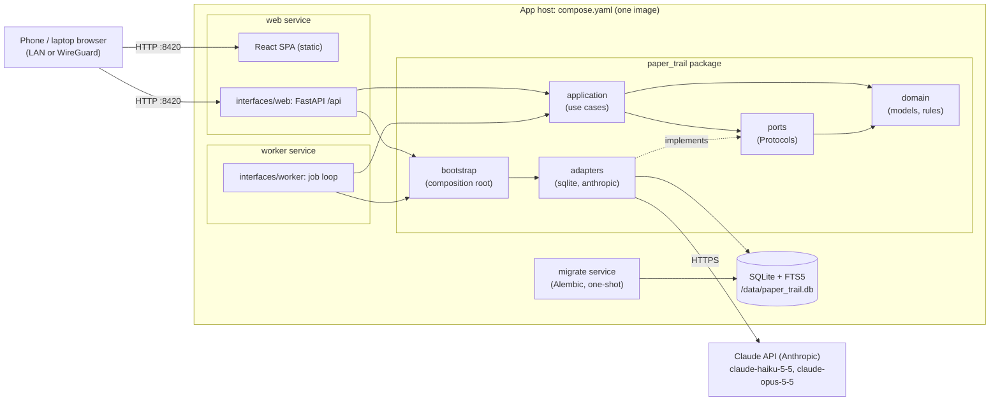
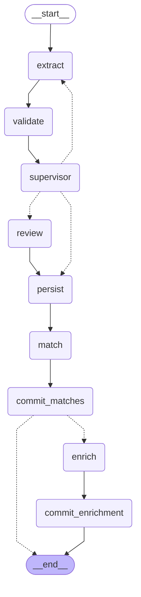
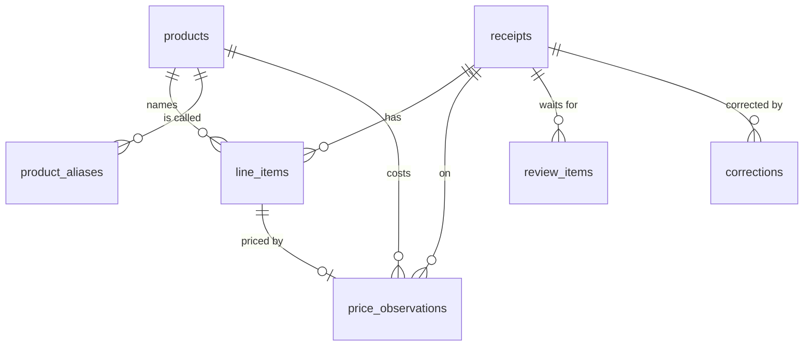

# Paper Trail

Paper Trail turns photos of receipts into a searchable record of what you bought, where, and at
what price, with a price history for every item. A small team of agents (extraction, validation,
product matching, enrichment) built with LangGraph processes each receipt: Claude reads the
photo item by item, code checks that every number adds up, and a second, stronger Claude model
reads it again when it does not. It is a FastAPI + React app that runs in Docker on a home
server; the database and your photos stay on that server, and each photo is sent to Anthropic
to be read (see [Data and privacy](#data-and-privacy)).

The phone web app is the main way in: scan a receipt, fix the ones that need a person, browse
receipts and products, and follow each product's price across stores. A CLI and an MCP server
reach the same agents and tools for batch runs and experiments. What is planned next is in
[`docs/ROADMAP.md`](docs/ROADMAP.md).

## Prerequisites

- **Docker** with Docker Compose v2 (Docker Engine on Linux, or Docker Desktop)
- **Make** and a POSIX shell (bash)
- **Git**
- An **Anthropic API key**, for reading receipt photos

That is all: everything else runs in containers, so nothing is installed on the host.

## Quick start

```sh
git clone <this repository> paper-trail && cd paper-trail
cp .env.example .env
# Edit .env: ANTHROPIC_API_KEY=<your key>
#            PAPER_TRAIL_BIND_ADDR=<the server's LAN address>, e.g. 192.168.1.10
#            PAPER_TRAIL_WEB__ALLOWED_HOSTS=<that address and the server's host name>
make build up
```

Open `http://<server LAN address>:8420` on your phone (over the LAN, or WireGuard when away;
see [Using the web app](#using-the-web-app)).
`make ps` shows `web` and `worker` as `healthy` once the stack is up. Nothing listens on
`0.0.0.0`: with the default `PAPER_TRAIL_BIND_ADDR=127.0.0.1` the app is reachable only from the
server itself at `http://127.0.0.1:8420`.

The key lives only in `.env` (git-ignored). Compose hands `.env` to `web`, `worker`, `cli` and
`mcp` through `env_file` (a key exported in your shell is not passed on); `migrate` blanks it.
The dev tooling containers (`make test`, `make shell`) mount the repository at `/app`, and the
app's settings read `/app/.env` there too, so the key is readable inside them; the tests never
call the API (they use fakes). Without a key the app starts and everything that needs no model
works (browsing, imports, the catalog, prices, reviews); a receipt sent to the agents fails with
a message naming `ANTHROPIC_API_KEY`, and can be tried again (Try again on the phone) once the
key is set.

Claude calls cost money: about $0.001 per receipt on the extract model and about $0.04 for a
retry on the retry model. `PAPER_TRAIL_CLAUDE__MONTHLY_BUDGET_USD` (default 5.00) caps the
spend per UTC calendar month: it is checked before each call, and once it is reached receipts
fail, resumable, until the cap is raised or the month ends. Each call reserves its largest
possible cost before it starts, so processes running at once are admitted one at a time and
cannot all slip under the cap. A read is up to three attempts (a rate limit, an overloaded API,
a lost connection or a timeout is retried after a short pause), each reserved and charged on
its own. An attempt that starts just under the cap can overshoot it by what it costs; one that
times out or loses its connection may have been billed without saying for how much, so it is
charged at its largest possible cost: the cap can be overshot by one attempt's worth at most.
Every attempt's tokens and cost are recorded in the main database (`claude_calls`), whatever
`RUN_NAME` the receipt is processed in, so a named run never starts a budget of its own; the
main database must therefore be migrated before any run (`make migrate`; a named run exits 1
otherwise and never migrates it itself).

## Using the web app

Open the app in your phone's browser; you can add it to the home screen as a shortcut. (Installing
it as a full-screen app needs HTTPS, which this LAN setup doesn't provide.)
The tab bar is Home · Receipts · **Scan** (the centre button) · Products · Review, with a search
box in the header for products and receipts.

1. **Scan.** Take a photo of the receipt, or pick one (JPEG, PNG, WebP or HEIC), and send it. The
   same photo twice opens the receipt it already made.
2. **Reading.** Claude reads it in the background, usually in about 20 seconds; you can keep
   using the app. Home shows a "Reading your receipt…" card until it is done.
3. **Review.** A receipt whose numbers do not add up, or whose date is missing or implausible,
   waits in the Review tab (the badge counts them): the photo beside the reading, with the
   problems listed. Fix the fields and save, accept the reading as it is, or keep a reading that
   does not add up by giving a reason. A receipt that adds up skips this step.
4. **Receipts.** Listed by purchase date in month groups, with each month's total and number of
   trips. A receipt shows each item once, with its discount folded in ("saved $X") and repeated
   items as ×N; tap an item to open its product.
5. **Products and prices.** Each product appears once, with a sparkline of its price per unit,
   how the newest price compares with the average of earlier purchases (↓8%; within 2% is
   "steady"; "first time" when there is nothing to compare) and the price per L, kg or 100 g when its
   size is known. Chips filter by category, store or "To check". A product's page has a price
   chart with one line per store (1M, 6M, All), the lowest, average and last price per store,
   the cheapest store, and every purchase underneath, each linking to its receipt.
6. **Products to check.** Details Claude guessed for a new product are marked AI until you
   confirm them. Home ("Needs you") and the Review tab link to a queue that shows one product at
   a time: ✓ or ✕ each guessed field, Skip, or "All correct, next". If a field you confirm
   changed while you were looking, nothing is saved and you see the new values (rejecting or
   editing a field saves without that check).
7. **Failed receipts.** A receipt that could not be read says why (the monthly budget is used
   up, Claude was unavailable, no API key, an unreadable photo, or the app stopped while reading
   it) and has a **Try again** button, which continues from where it stopped or reads the photo
   again.

### The web API

The app talks to a JSON API under `/api`; the OpenAPI document is at `/api/openapi.json`, and
the TypeScript client is generated from it (ADR-0007). Writes from a browser must come from the
app's own origin (see [Data and privacy](#data-and-privacy)); curl and scripts send no `Origin`
and are served.

| Endpoint | What it does |
|---|---|
| `POST /api/receipts` | Upload a photo (multipart field `file`): `202` with the queued receipt, `200` with the existing one for a photo already sent, `413` above `UPLOAD__MAX_BYTES`, `415` for anything but a photo |
| `GET /api/receipts` | Receipts by purchase date, newest first (`limit`, `cursor`, `status`, `store`) |
| `GET /api/receipts/{id}` · `/image` | A receipt with its lines and an arithmetic report · its stored photo |
| `POST /api/receipts/{id}/retry` | Queue a `failed` receipt again (`409` if it is not failed or already queued) |
| `GET /api/reviews` · `/{id}` · `POST /{id}/resolve` | Open reviews · one review · accept, correct or force (with a reason) an answer |
| `GET /api/products` · `/to-check` · `/{id}` · `/{id}/purchases` | Products with recent prices · products to check · one product · its purchases |
| `PATCH /api/products/{id}` | Edit a product (each field sent is stamped `person`) |
| `POST /api/products/{id}/confirm` | Confirm its values; with `{fields, expected}`, only those fields, and `409` if a stored value differs from what you saw |
| `GET /api/summary?month=YYYY-MM` | The month's spending by week and store, and what is waiting (reviews, products to check, receipts being read) |
| `GET /api/search?q=` | Products and receipts matching every word (SQLite FTS5) |
| `GET /api/categories` · `/api/health` · `/api/health/ready` | Category values · liveness · readiness |

For example `curl -F file=@receipt.jpg http://192.168.1.10:8420/api/receipts`, then poll
`GET /api/receipts/{id}` until `status` is `completed`, `needs_review` or `failed`.

## Architecture

Hexagonal (ports and adapters): the domain and use cases know nothing about SQLite, Claude,
FastAPI or LangGraph. Every external dependency sits behind a small `Protocol` (a port) with one
adapter, and tests swap in in-memory fakes. The layering is enforced by import-linter in
`make lint`.



- **web** serves the JSON API under `/api` and the built single-page app from the same origin
  (no CORS). **worker** runs the receipt pipeline. **migrate** applies database migrations once
  before either starts. All three run the same image as a non-root user with a read-only root
  filesystem.
- The single-page app is React 19, Vite, TanStack Router and Query, and Tailwind; it is built
  into the image and served by `web` (ADR-0014).
- The queue is a `jobs` table in the same database (ADR-0005). An upload, a review answer or a
  Try again queues a job; the web process never runs the graph. The worker takes one job at a
  time under a lease it renews by heartbeat, and the graph saves a checkpoint after every node,
  so a receipt continues from where it stopped. On `make down` or a redeploy the worker lets the
  running step finish (`PAPER_TRAIL_WORKER__SHUTDOWN_GRACE_S`, 90 s, enough for one Claude read;
  compose waits 100 s before killing it). If the worker dies mid-job, the job is taken again
  once its lease expires and counts an attempt; a job that used up its attempts (2) is not run
  again: it and its receipt are marked failed ("stopped unexpectedly"), and Try again picks it
  up from its checkpoint.
- One SQLite file holds everything (relational data, full-text index, agent checkpoints,
  the job queue, the Claude spend).
- The TypeScript API client is generated from the backend's OpenAPI document
  (`make api-client`), so the contract is defined once, in Python.

Design decisions are recorded as ADRs in [`docs/adr`](docs/adr/); the staged plan is in
[`docs/PLAN.md`](docs/PLAN.md).

## Importing receipts

Besides photos, a receipt can be recorded from a JSON file with the CLI, for example one typed
by hand when a photo cannot be read:

```sh
docker compose run --rm -v "$PWD/tests/data/receipts:/import:ro" web \
  receipts import /import/costco_simple.json            # add --dry-run to only check it
docker compose run --rm web receipts show 1             # the receipt as JSON
```

The import prints `receipt <id>: <status>` and every arithmetic issue. A receipt that does not
add up is still recorded, as `needs_review`, with an open review item; one that does is
`completed` and, when its purchase date is known, adds a price observation for each `item` line
that names a product (a deposit, discount or fee line gets a product only when the file names
one for it, and is never priced itself; a discount that names an item's code, such as
`TPD/1234567`, is applied to that item's paid price, see "What gets saved" below). A discount
line's `applies_to` (the 0-based position of the item it reduces) sets that link by hand; the
rest are found from the codes. `--dry-run` also lists each discount and the item it applies to,
or why it stays on the receipt. Card numbers are masked before anything is stored or logged.
Invalid files exit with status 2 and name the offending field. The format (unknown fields are
errors, amounts are integer cents; the lines add up to the subtotal, and subtotal plus tax to
the total; `tests/data/receipts/costco_simple.json` is a full example):

```json
{
  "store_name": "COSTCO WHOLESALE #1234",
  "purchased_on": "2026-11-01",
  "currency": "CAD",
  "subtotal_cents": 158,
  "tax_cents": 52,
  "total_cents": 210,
  "payment_last4": "1111",
  "items": [
    {
      "raw_text": "KS 2% MILK 4L",
      "description": "Kirkland 2% Milk 4 L",
      "quantity": "2",
      "unit_price_cents": 329,
      "line_total_cents": 658,
      "product": "Kirkland 2% Milk 4 L",
      "category": "dairy_eggs"
    },
    { "raw_text": "TPD/1234567", "kind": "discount", "line_total_cents": -500 }
  ]
}
```

Only `store_name`, `total_cents`, `items`, and each item's `raw_text` and `line_total_cents` are
required. Defaults: `currency` `CAD`, `quantity` `"1"` (a decimal string), `kind` `item` (or
`discount`, `deposit`, `fee`), `description` the raw text. `GET /api/categories` lists the
category values.

## Processing receipts with the agents

The agents run from the command line in the on-demand `cli` service, which mounts the receipts
folder `PAPER_TRAIL_RECEIPTS_DIR` (default `./receipts`, git-ignored; set your own folder in `.env`)
read-only at `/receipts`. Set `ANTHROPIC_API_KEY` in `.env` first, then:

```sh
make build                                         # once, and after pulling changes
make process RECEIPTS=costco.jpg RUN_NAME=try1     # one photo, in its own run "try1"
make process RUN_NAME=e1-feedback ARGS="--verbose" # the whole folder
make pt ARGS="review list --run e1-feedback"       # receipts parked for a person
make pt ARGS="review show 3 --run e1-feedback"
make pt ARGS="review resolve 3 --accept --run e1-feedback"
make graph                                         # the agents' graph as Mermaid
```

The graph, as `make graph` prints it:



`extract` sends the photo (upright, long edge at most 2576 px, JPEG) to Claude with the
`extraction/v3` prompt and a structured-output schema: the receipt, every purchased item with
its printed text, code, department, quantity, unit, unit price, regular price, discount and
price paid, and the adjustments (deposits, fees, discounts on the whole order). Claude only
transcribes: it copies every price as printed, as text, and never adjusts a value to make the
totals match; Python converts and adds them up (ADR-0017). Card numbers in the answer are masked
before it is kept anywhere. `validate` checks in code that each item's regular price minus its
discount is its price paid, that a weighed item's quantity times its unit price matches its
regular or its paid price (within 1 cent), that the prices paid plus the adjustments make the
subtotal, and the subtotal plus the taxes the total; and that the store and date are known. The
`supervisor` saves a valid receipt (`persist`); otherwise it has the retry model
(`PAPER_TRAIL_CLAUDE__RETRY_MODEL`) read the photo again with the failures listed
(`PAPER_TRAIL_GRAPH__MAX_ATTEMPTS`, default 2), then sends the receipt to a person (`review`).
Each item is stored as an item line, followed by a discount line linked to it when it had a
discount, so the price history shows its regular price, its discount and what was paid. Then
`match` finds each line's product and `commit_matches` (the supervisor) links them, with a
price observation per line, and completes the receipt. Finally `enrich` lists the products this
receipt created and `commit_enrichment` describes them: from the catalog entry that named them
(the PLU table), then the product databases for a barcode, else Claude's guess (see
[Product lookups and guesses](#product-lookups-and-guesses)); nothing there can fail the
receipt, which is already complete (`PAPER_TRAIL_GRAPH__ENRICHMENT=false` skips both). The terminal
shows one block per receipt: every tool call, Claude read and routing decision, with times; the
same trace, with each read's model, tokens, stop reason and the photo's SHA-256 (never the
photo), is written to `/data/runs/<run>/traces/receipt-<id>-<UTC time>.json`, and a batch
summary to `/data/runs/<run>/summary.json`.

- `RUN_NAME=<name>` gives the run its own database and traces under `/data/runs/<name>/`
  (created and migrated on first use), so experiment arms never mix. Without it the main
  database is used (run `make migrate` first) and traces go to `/data/runs/main/`. Images are
  stored once, by content, in `/data/images` for every run; the same photo twice in one run is
  reported as a duplicate.
- `ARGS` takes the flags of `paper-trail process`: `--max-attempts N` (1 or 2),
  `--no-feedback` (retry with a generic line instead of the failures),
  `--verbose` (print the feedback and Claude's answers), `--no-color`.
- Exit codes: 0 every receipt completed, was parked for review or paused, 1 `--resume` has
  nothing to resume (unknown receipt, finished run, or a review waiting: use `review resolve`),
  or `--resume`, `--reprocess` or `review resolve` met a receipt the worker (or another command)
  is processing: the message names its job; try again once it has finished. 2 a usage error, 3 a receipt failed, 4 a Claude read stopped the batch (the API failed or
  refused, the answer was cut off, there is no key, or the monthly budget is reached): the
  receipt is `failed` and keeps its checkpoint, and the output prints the
  `paper-trail process --resume <id>` command that continues it.
  A photo that Claude refuses every time, or whose answer is always cut off, has no automatic
  way out yet: `--resume` sends it again and gets the same answer. Such a receipt stays
  `failed`; entering it by hand (`receipts import`) is the way out for now.
- `review resolve ID` takes `--accept` (keep the extraction the review holds) or `--file F` (a
  corrected receipt in the import format below); a receipt that does not add up needs
  `--force --reason TEXT`. It resumes the receipt's graph from its checkpoint and completes it.
- Validation feedback is untrusted (it quotes Claude's reading of the receipt): before it goes
  into the prompt's `<validation_feedback>` block, any such tag inside it is escaped, so text
  printed on a receipt cannot close the block early.
- `make smoke-claude` (opt-in, never part of `make check` or CI) reads the receipts folder with
  the real API into a new run `smoke-claude-<UTC time>` each time, and ends with a table per
  receipt (`process --table`): store, items, the lines' sum against the subtotal, total, whether
  it adds up, the models, attempts and cost. It needs `ANTHROPIC_API_KEY` and costs money.

### Photos sent from the phone

A photo sent from the app (or `POST /api/receipts`) is stored, its receipt is created
`processing` and queued, and the `worker` reads it exactly as `process` does (same budget, retry
and review), one receipt at a time. When Claude cannot read it (no key, the API down, the budget
reached) the receipt is `failed` with its checkpoint and a reason, and is not retried on its
own: Try again in the app (`POST /api/receipts/{id}/retry`) or
`make pt ARGS="process --resume ID"` continues it. How the worker recovers from a crash is under
[Architecture](#architecture).

### Matching, corrections and resuming

Every ITEM line is matched to a product within its store, and no model is asked (ADR-0018). A
line with a product code (a barcode, a PLU, or a store's own item number such as Costco's; the
code Claude read on the line, never one parsed out of its text) is identified by that code:

1. the code already names one of our products (`catalog`; `product_codes`);
2. a person's correction for that text at that store (`memory`), which also teaches the code;
3. a reference source knows the code (the PLU table, `<data_dir>/catalog/plu.csv`): a new
   product named by it (`new`, the name's source `plu`);
4. else a new product named by the printed text without its code and tax flags (`new`,
   `receipt_text`).

A line without a code is matched by a person's correction (`memory`), then an exact alias at
that store (`alias`), else it is a new product named by its printed text. An alias of another
store, or a global one, never links a line, so products are not linked across stores by their
text; a shared barcode or PLU is the same product at every store, while a store's own codes
belong to that store. Linking products across stores (comparison groups) is planned, not built.
`PAPER_TRAIL_CATALOG__ENABLED=false` (or `process --no-catalog`) matches coded lines by their
text instead, still without a model. Products created that way get no code, so with the catalog
on again the same line is not found by its code and makes a second product. Deposit, fee and
discount lines, and generic texts such as
`PRODUCE`, are never matched, and neither is a line a person named a product for when resolving
a review. A NOTE per receipt counts the sources (`catalog 9 (store 5, gtin 3, plu 1) · alias 1 ·
new 4 (printed text 3, plu 1)`), and each line's source is stored in
`line_items.match_source`. A product created from a source entry is then described from that
entry (`describe_from_catalog`: PLU name, category `produce`, tag `organic`); every product
field records its source (`products.field_sources`), a person's value is never overwritten, and
a category a person gave the same line at the same store (a `category` correction) wins.

```sh
make process RECEIPTS=costco-1.jpg RUN_NAME=e2     # new products
make process RECEIPTS=costco-2.jpg RUN_NAME=e2     # the same items: linked by their codes, no model call
docker compose run --rm -e PAPER_TRAIL_DATABASE_PATH=/data/runs/e2/paper_trail.db \
  cli receipts show 2                               # the lines and their positions
make pt ARGS="items correct 2 0 --run e2 --new-product 'Kirkland Organic Eggs 24'"
make process RECEIPTS=costco-2.jpg RUN_NAME=e2 ARGS="--reprocess"   # line 0 now by its code
make process RECEIPTS=costco-3.jpg RUN_NAME=e2 ARGS="--interrupt-after validate"
make pt ARGS="process --run e2 --resume 3"          # continues after validate
```

- `items correct RECEIPT_ID POSITION (--product-id N | --new-product NAME) [--category C]
  [--run NAME]` relinks one line (`POSITION` is the line's 0-based `position`, as `receipts
  show` prints it), moves its price observation and remembers the correction, so the next line
  with that text at that store links to the product without a search. When the line starts with
  a product code, the code now names that product (`catalog.learned`), replacing a wrong
  mapping. `--new-product` and `--category` are a person's values (source `person`). It calls
  no model. Exit 1 for an unknown receipt, line or product, 2 for a usage error.
- `--interrupt-after NODE` pauses each receipt after a node of the graph (`extract`,
  `validate`, `supervisor`, `review`, `persist`, `match`, `commit_matches`, `enrich`,
  `commit_enrichment`) and prints the resume command; the checkpoint
  is in the run's database. A saved receipt stays `processing` (stage `matching`) until
  `commit_matches` has linked its lines.
- `--resume ID` continues a paused receipt, or one stopped by a Claude read or by a crash, from its last completed node: nothing before it runs again, and the trace records
  `resumed_from`. It takes no PATH (so it goes through `make pt`, not `make process`), and the
  `--run` the receipt was processed in, but none of the flags that would change the run's
  configuration (`--max-attempts`, `--no-feedback`, `--no-catalog`: exit
  2). A run saved by an older version (OCR and local models) cannot be resumed (exit 2): answer
  its review with a corrected file (`review resolve ID --file F`) or read the photo again with
  `--reprocess`. A receipt
  waiting for a person is answered with `review resolve`, not resumed. A run that fails while
  products are being described leaves the receipt `failed` with its lines, codes and prices
  saved; `--resume` describes the rest and completes it.
- `--reprocess` has Claude read an already stored photo again, on a new thread (a pending
  review is dismissed). Without it the same photo is reported as a duplicate.

### Product lookups and guesses

Each product a receipt creates is described, field by field, from the first source that knows
it (claude-extraction plan D3, D4):

1. the PLU table (stamped `plu`), or another product a person or a database named under the
   same code; never the product itself or one only printed or guessed;
2. for a barcode (GTIN), the open product databases: [Open Food Facts](https://world.openfoodfacts.org),
   then [Open Beauty Facts](https://world.openbeautyfacts.org) and
   [Open Products Facts](https://world.openproductsfacts.org) (stamped `off`), and UPCitemdb last
   when it is on (stamped `upc`). They give the name, brand and size; the next one is asked only
   while one of those is missing;
3. Claude's guess (the extract model, `PAPER_TRAIL_CLAUDE__EXTRACT_MODEL`, counted in the monthly
   budget), when the name or the category is still open: name, brand, size, category and tags,
   stamped `llm`. Claude is told the printed text, the store, the department heading, the code
   and an Open*Facts answer, never a price, a date or a UPCitemdb answer.

A database's answer counts as confirmed; a guess does not, so it shows in `catalog todo` (as
`suggested`) until you `catalog confirm` it, fix it with `catalog add` or `items correct`, or a
database answers on a later run. Only a field that is empty, printed (`receipt_text`) or guessed
(`llm`) is ever written: a person's, a database's or a legacy model's value is kept, and a
category read from a printed department heading is never replaced by a guess. A product is
guessed once.

**Only the barcode is sent** to the databases: no store, receipt, price or date. The requests
carry a generic User-Agent (`PaperTrail/1.0 (personal receipt app; +https://github.com/fabioo2/paper-trail)`),
go out one at a time, at most one every 4 s per Open*Facts database and one every 10 s and 100 a
UTC day to UPCitemdb. Answers are kept in the `product_lookups` table: a hit for good, a "not
found" for 30 days; an error or a rate limit is never kept, so the next run asks again.
costco.ca is never contacted. Every request happens outside a database write, and each product
is written in its own transaction, so a crash leaves the products already done described and
the next run (or `process --resume`) finishes the rest without asking again.

- `PAPER_TRAIL_LOOKUP__OPEN_FACTS` (default `true`): ask the three Open*Facts databases.
- `PAPER_TRAIL_LOOKUP__UPCITEMDB` (default **`false`**): ask UPCitemdb's free trial endpoint
  (no key, 100 requests a day). It is off because its terms do not clearly allow keeping its
  answers; read them before turning it on. Its answers are never sent to Claude.
- `PAPER_TRAIL_LOOKUP__TIMEOUT_S` (default `10`, at most `60`): per request.

Open Food Facts, Open Beauty Facts and Open Products Facts data is © their contributors and
available under the [Open Database License (ODbL)](https://opendatacommons.org/licenses/odbl/1-0/);
the fields Paper Trail keeps from them are stamped `off`.

Products stored before lookups existed are described by `catalog enrich` (a dry run that lists
each product, its open fields and the steps that may fill them; `--apply` does it and prints
`looked up N, guessed M, unchanged K, failed F`). Back up the database before the first
`--apply`.

### Naming products by their codes

Nothing names a Costco item number for you: the databases do not know store item numbers, so a
new coded product keeps its printed text or Claude's guess until a person names it. The
`catalog` commands do that; only `catalog enrich --apply` calls Claude or the network. Every
command except `plu-import` takes `--run NAME` (that run's database; without it the main one,
which must be migrated).

The Costco workflow:

1. `catalog todo --store costco` lists the products nobody has confirmed yet, most bought first:
   product | name | name source | code | times bought | last paid | last date | a costco.ca
   search link.
2. Open the link in your own browser. The app only prints it; it never requests the link.
3. `catalog add costco 1362394 "Choc Pistachio Bars" --brand Kirkland --size "1.36 kg"
   --category snacks_candy` names the product (shown before and after, then `y` to save;
   `--yes` skips the question). The product the code already names is filled in place, so
   every past line keeps pointing at it; the next receipt links to it by its code.

Its limits: (a) a warehouse item number often matches the costco.ca item number, but not always:
a search may find nothing or a different pack size, so check the page against the printed text;
(b) warehouse-only items (produce, bakery, many fresh items) are usually not online: name them
from the shelf tag, the receipt or a fan site, by hand; (c) the link is a convenience only:
the app copies nothing from the page.

- `catalog todo [--store S] [--limit N] [--json] [--run NAME]`: the list above, coded products
  and uncoded ones (`-` for no code), a guessed name shown as `suggested`.
- `catalog confirm PRODUCT_ID [--run NAME]`: accepts the product's current name, brand, size,
  category and tags as yours (stamped `person`; an empty field stays empty, so a later lookup
  may still fill it). Exit 1 for an unknown product.
- `catalog enrich [--apply] [--run NAME]`: looks up or guesses the stored products (above). Exit
  1 when a product failed (the others are written); when the monthly Claude budget is reached
  the rest are reported as skipped.
- `catalog add STORE CODE ("NAME" | --product ID) [--brand B] [--size "1.36 kg"] [--category C]
  [--replace] [--yes] [--run NAME]`: the code is read with the store's profile (a barcode or a
  PLU names the product at every store, a store's own code only at that store); what you give
  is stamped `person`. Renaming a product a person already named needs `--replace`.
  `--product ID` makes the code name an existing product instead (its old product and lines
  are left as they are, and reported). Exit 2 for an unreadable code or size, 1 for `n`.
- `catalog list [--store S] [--scheme gtin|plu|store] [--json] [--run NAME]`: the stored codes,
  their products and who attached them.
- `catalog remove --store S --code C [--run NAME]`: forgets what a code names; the product and
  its lines stay.
- `catalog lookup "<line or code>" --store S [--run NAME]`: how a line's code is read and which
  source knows it (our product, the PLU table, or none). Writes nothing.
- `catalog plu-import FILE`: writes the PLU table, `<data_dir>/catalog/plu.csv`
  (`PAPER_TRAIL_CATALOG__PLU_PATH`), from the IFPS PLU database export (ifpsglobal.com, "Export all"
  -> .csv). Keep the export under the git-ignored `data/` of the checkout or outside it; it is never
  committed. The `cli` container does not see the checkout, so mount the file for the one run:
  `docker compose run --rm -v "$PWD/data/ifps-plu.csv:/import/ifps-plu.csv:ro" cli catalog
  plu-import /import/ifps-plu.csv`. Each code is named `<Commodity>, <Variety>, <size>` (`4046` ->
  `Avocados, Hass, small`; an empty or `Retailer Assigned` variety and an empty or `All Sizes` size
  are left out), and an organic `9xxxx` code reads as `Organic ` + that name. It prints e.g. `1435
  imported, 113 skipped (111 retailer assigned, 2 duplicate)`: retailer-assigned blocks name no
  product, a repeated code keeps its first row, and rows with an invalid PLU or no commodity are
  skipped too. The file is replaced in one step (a failed import leaves the old one); exit 1 when
  nothing is importable. A running MCP server (`make mcp-up`) reads `plu.csv` once, so restart it
  after an import (`make mcp-down mcp-up`); `process` and the other commands read it fresh each run.
  The worker also reads it once, so restart it too (`make restart`); `web` does not use it.

### What gets saved: a product and its price history

Every purchase line ends up linked to one product, and every product keeps one price
observation per time it was bought, so the price history of anything is one query away. An
example (the prices are made up), gold kiwis bought at Costco on two receipts (three lines):

```json
{
  "product": {
    "id": 24,
    "canonical_name": "GOLD KIWI",
    "brand": null,
    "size_value": null,
    "size_unit": null,
    "category": null,
    "tags": [],
    "field_sources": { "canonical_name": "receipt_text" },
    "codes": [{ "scheme": "store", "store_key": "costco", "code": "3139415", "source": "receipt" }]
  },
  "price_history": [
    {
      "observed_on": "2026-09-24", "store_name": "Costco Wholesale", "receipt_id": 4,
      "line_item_id": 53, "raw_text": "3139415 GOLD KIWI", "match_source": "catalog",
      "quantity": "1", "unit_price_cents": 1499, "line_total_cents": 1499, "currency": "CAD",
      "discount_cents": -300, "unit_discount_cents": -300, "paid_cents": 1199, "on_sale": true
    },
    {
      "observed_on": "2026-11-05", "store_name": "Costco Wholesale", "receipt_id": 2,
      "line_item_id": 34, "raw_text": "3139415 GOLD KIWI", "match_source": "new",
      "quantity": "1", "unit_price_cents": 1499, "line_total_cents": 1499, "currency": "CAD",
      "discount_cents": -300, "unit_discount_cents": -300, "paid_cents": 1199, "on_sale": true
    },
    {
      "observed_on": "2026-11-05", "store_name": "Costco Wholesale", "receipt_id": 2,
      "line_item_id": 36, "raw_text": "3139415 GOLD KIWI", "match_source": "new",
      "quantity": "1", "unit_price_cents": 1499, "line_total_cents": 1499, "currency": "CAD",
      "discount_cents": -300, "unit_discount_cents": -300, "paid_cents": 1199, "on_sale": true
    }
  ]
}
```

The other receipt's line was linked by the code the first one attached (`match_source`
`catalog`), without a model call; nothing named the product but its printed text, so it keeps
that name and no category until a person or a data source names it. Each of these lines was followed by a `-3.00` instant-savings line naming
the kiwi's code (`0000399102 / 3139415`), stored as its own `discount` line and linked to the
item above it with that code: the regular 14.99 is the price history; 11.99 is what was paid. A
discount that cannot be tied to one item (`0000398549 / MULTIPLE`, or a line without a code)
stays on the receipt, never guessed or prorated. A discount larger than the nearest free item
with its code stays on the receipt too, unless a later discount with the same code takes that
item: then it links to an earlier, larger item with the code, or, with none, is reported as
having no item (`no_item`). The upgrade that adds discounts (migration 0004) refuses to run
while any price observation has a negative line total, and lists their ids; find them with
`SELECT id FROM price_observations WHERE line_total_cents < 0`, delete or correct them, and
upgrade again. Receipts stored before discounts were linked are brought up to date with
`paper-trail prices backfill` (a dry run; `--apply` writes, and `--run NAME` and `--receipt ID`
narrow it). It looks at completed receipts only: one that was still being processed when the
upgrade ran (saved, not yet matched) gets its prices at discount 0 when it completes, so run the
backfill once more after it has. If a receipt fails, the command stops with exit status 1 naming
it; the receipts before it stay applied and running it again finishes the rest. The tables
behind it:



- `receipts`: store, date, subtotal, tax, total (integer cents), status (with the reason when
  it failed) and the stored photo (receipts read before Claude also keep their masked OCR text).
- `line_items`: each line in order (an item, then its discount when it had one, then the
  adjustments): raw text, kind (`item`, `discount`, `deposit`,
  `fee`), quantity and its unit (`each`, `kg`, `lb`, ...), unit price, line total, and the product it was matched to, with how
  (`memory`, `catalog`, `alias`, `new`; `vector` and `llm` only on lines matched before product
  codes); a `discount` line's `applies_to_position` names the
  item line it reduces.
- `products`: name, brand, size, category and tags, each with its source in `field_sources`
  (`receipt_text`, `person`, `plu`, `legacy_model` for values a model wrote before 0006); its
  names are in `product_aliases`.
- `product_codes`: the codes that name a product: a barcode or PLU at every store, a store's own
  code at that store, with who attached it (`receipt`, `plu`, `correction`, ...). A person's
  mapping replaces another product's; a machine's never does.
- `price_observations`: one row per purchased item line on a dated receipt: product, receipt,
  line, store, date, quantity, the regular unit price and total, and the discount applied to the
  line (per line and per unit), what was paid and whether it was on sale. The regular prices are
  the price history; the paid amounts are the spending. Discounts that cannot be tied to one item
  (`MULTIPLE`) stay on the receipt, so what was spent on items is the paid amounts plus those.
  A negative item line (a return on a receipt a person forced through review) gets no row; the
  trace notes it.
- `corrections` (a person's fixes, the long-term memory matching reads first), `review_items`
  and `jobs`.

The product page in the app shows this history (`GET /api/products/{id}/purchases`); with SQL
it reads:

```sql
SELECT o.observed_on, r.store_name, o.quantity, o.unit_price_cents, o.line_total_cents,
       o.paid_cents, o.on_sale
FROM price_observations o JOIN receipts r ON r.id = o.receipt_id
WHERE o.product_id = 24 ORDER BY o.observed_on;
```

### Tools, allowlists and MCP

Agents never touch the database: every read or write is a tool call checked against the
calling agent's role (only the supervisor's tools write). The same tools can be listed and
called from the command line, in-process or through the MCP server:

```sh
make pt ARGS="tools list"                          # every role and the tools it may call
make pt ARGS="tools list --role matching"
make pt ARGS="tools call --role validation check_arithmetic '{\"receipt\": {...}}'"
make pt ARGS="tools call --role matching save_receipt '{\"receipt_id\": 1, \"draft\": {}}'"
make mcp-up                                        # the MCP server on 127.0.0.1:8421
make pt ARGS="tools list --role matching --transport mcp"
make mcp-down
make process RUN_NAME=e3-mcp ARGS="--transport mcp"
```

- `tools call` prints the result as JSON and exits 0; it exits 5 when the role may not call the
  tool (`denied: role=matching tool=save_receipt`, also logged as `tool.denied`), 2 for a usage
  error (payload not a JSON object, unknown tool, input the tool refuses), and 1 when the
  database is not migrated, the MCP server is unreachable or the tool itself failed.
- `make mcp-up` serves one MCP endpoint per role at `http://127.0.0.1:8421/mcp/<role>/`
  (streamable HTTP) over the main database; `tools --transport mcp` talks to it through
  `PAPER_TRAIL_MCP__URL` (default `http://mcp:8000`, the service inside compose). It has no
  authentication and its supervisor tools write, so it is published on loopback only and
  answers only the Host names `127.0.0.1`, `localhost` and `mcp`.
- `process --transport mcp` (or `PAPER_TRAIL_TOOLS__TRANSPORT=mcp`) calls the tools over MCP
  too, but serves its run's own tools on a loopback port inside the command (a standalone
  server would write to the main database, not the run's), so it needs no `make mcp-up`. The
  outcome and the trace are the same as in-process; only the times differ.

## Make targets

`make` (or `make help`) lists them. Every target runs in Docker.

| Target | What it does |
|---|---|
| `make build` | Build the runtime image and the dev tooling images |
| `make up` / `make down` | Start / stop the runtime stack (`migrate`, `web`, `worker`); `down` keeps the data volume |
| `make restart` | Restart `web` and `worker` |
| `make logs` / `make ps` | Follow the logs / show the containers and their health |
| `make migrate` | Apply the migrations baked into the built image (`make build migrate` after adding one) |
| `make backup` | Back up the database now (see [Backups and restoring](#backups-and-restoring)) |
| `make revision m="..."` | Create a hand-written migration (`id=0002` sets the revision id) |
| `make shell` / `make fe-shell` | A shell in the Python / frontend dev container |
| `make lock` | Re-resolve Python dependencies into `uv.lock` |
| `make lint` / `make format` | Ruff lint + format check + import-linter / auto-fix and format |
| `make typecheck` | mypy `--strict` |
| `make test` | All Python suites in parallel with branch coverage (fails under 90 %) |
| `make test-fast` | Unit, contract and integration suites in parallel, no coverage: the day-to-day loop |
| `make test-unit` / `make test-integration` | The unit and contract suites / the integration suite |
| `make fe-lint` / `make fe-format` / `make fe-typecheck` / `make fe-test` / `make fe-build` | ESLint + Prettier check / Prettier write / `tsc` / Vitest with coverage / Vite build (each first runs `fe-deps`) |
| `make fe-deps` / `make fe-install` | Reinstall frontend dependencies if `package-lock.json` changed / always (`npm ci`) |
| `make fe-dev` | Vite dev server on `:5173`, proxying `/api` to `web` |
| `make api-client` / `make api-check` | Regenerate `frontend/openapi.json` and the TS schema / fail if they drifted from the backend |
| `make secrets` | Self-test the secret scan, then scan git history and the working tree (gitleaks) |
| `make smoke` | Start the stack with your `.env` and smoke-test it from inside the network (leaves it running) |
| `make container-checks` | Inspect the built image and a throwaway stack (size budget, user, hardening) |
| `make pre-commit` / `make hooks` | Run the pre-commit hooks on every file and scan staged changes / point git at `.githooks` |
| `make check` | Fast gate: lint, types, tests, frontend checks, API contract, secrets |
| `make ci` | Full gate: `build`, `check`, `smoke`, `container-checks`; leaves the stack running |
| `make process` | Process receipts with the agents: `RECEIPTS=<file or folder>`, `RUN_NAME=<run>`, `ARGS="<flags>"` |
| `make smoke-claude` | Live smoke: Claude reads `RECEIPTS` into a new run and prints a table (needs `ANTHROPIC_API_KEY`; costs money; never part of `check` or CI) |
| `make pt ARGS="..."` | Run any `paper-trail` command in the `cli` service, e.g. `ARGS="review list"` |
| `make graph` | Print the agents' graph as Mermaid |
| `make mcp-up` / `make mcp-down` | Start / stop and remove the MCP tool server (`127.0.0.1:8421`); the rest of the stack is untouched |
| `make outdated` | Report newer Python, npm and base-image versions (changes nothing) |
| `make clean` | Remove caches, coverage and build output (never the data volume) |

## Configuration

Every setting is an environment variable in `.env` (git-ignored), documented with its default in
[`.env.example`](.env.example); all are optional. After changing one, `make up` recreates the containers it affects (`make
restart` does not re-read `.env`).

Deployment (read by compose):

- `PAPER_TRAIL_BIND_ADDR` (default `127.0.0.1`): the host address the web port is published on.
  Set it to the server's LAN address to use the app from your phone. `PAPER_TRAIL_PORT` (default
  `8420`) is the host port.
- `PAPER_TRAIL_DATA_VOLUME` (default the `paper-trail-data` named volume): where the database and
  images live; an absolute host folder works too, owned by UID 1000.
- `PAPER_TRAIL_RECEIPTS_DIR` (default `./receipts`): the folder of photos `make process` reads.

The app:

- `PAPER_TRAIL_WEB__ALLOWED_HOSTS` (default: none): the host names or IPs you open the app by,
  comma-separated, without scheme or port (e.g. `192.168.1.10,my-server`), besides `localhost`,
  `127.0.0.1`, `::1` and `web`. Any other `Host` is refused with 400
  ([ADR-0020](docs/adr/0020-host-and-origin-checks.md)), so add every name you use, the
  WireGuard address included.
- `ANTHROPIC_API_KEY` (no prefix): the Claude API key. Without it a receipt fails with a message
  naming this variable.
- `PAPER_TRAIL_CLAUDE__EXTRACT_MODEL` / `__RETRY_MODEL` (defaults `claude-haiku-5-5` /
  `claude-opus-5-5`; a model without a known price is refused), `__TIMEOUT_S` (default `300`,
  per request, at most `600`: the retry model can take minutes, and a request given up on is
  still billed) and `__MONTHLY_BUDGET_USD` (default `5.00`, per UTC month, checked before each
  call; `0` stops every call).
- `PAPER_TRAIL_GRAPH__MAX_ATTEMPTS` (default `2`: the extract model, then one retry),
  `__FEEDBACK` (default `true`: the retry is told what failed) and `__ENRICHMENT` (default
  `true`: describe new products).
- `PAPER_TRAIL_LOOKUP__OPEN_FACTS` (default `true`), `__UPCITEMDB` (default `false`) and
  `__TIMEOUT_S` (default `10`): the product databases asked for a barcode (see
  [Product lookups and guesses](#product-lookups-and-guesses)).
- `PAPER_TRAIL_CATALOG__ENABLED` (default `true`: match coded lines by their code) and
  `__PLU_PATH` (default `<data dir>/catalog/plu.csv`).
- `PAPER_TRAIL_UPLOAD__MAX_BYTES` (default `15000000`) and `__MAX_PIXELS` (default `40000000`):
  larger uploads are refused.
- `PAPER_TRAIL_BACKUP__AT` (default `03:30`, local time) and `__KEEP` (default `14`): the
  nightly backup (see [Backups and restoring](#backups-and-restoring)).
- `PAPER_TRAIL_WORKER__SHUTDOWN_GRACE_S` (default `90`): how long a running step may take to
  finish after the worker is asked to stop; keep the worker's `stop_grace_period` in
  `compose.yaml` (100 s) above it. `__POLL_INTERVAL_S` (default `1`) and
  `__HEARTBEAT_INTERVAL_S` (default `10`) rarely need changing.
- `PAPER_TRAIL_TOOLS__TRANSPORT` (default `inprocess`, or `mcp`): how the agents call their
  tools; `PAPER_TRAIL_MCP__URL` is the server `tools --transport mcp` uses, and
  `PAPER_TRAIL_MCP__TIMEOUT_S` (default `330`) must be above `PAPER_TRAIL_CLAUDE__TIMEOUT_S`.
- `PAPER_TRAIL_LOG_LEVEL` (default `INFO`) and `PAPER_TRAIL_LOG_FORMAT` (`json`, or `console`).

## Backups and restoring

Every night at `PAPER_TRAIL_BACKUP__AT` (default `03:30`, local time) the worker copies the
database to `/data/backups/paper_trail-YYYYMMDD.db` on the data volume and keeps the newest
`PAPER_TRAIL_BACKUP__KEEP` (default `14`). A worker that was stopped at that time makes the
day's backup as soon as it runs again. The copy is taken online (the app keeps working), checked
with SQLite's `integrity_check`, and only then given its name, so every file there is a whole,
checked database; the worker logs `backup.written` or `backup.failed`. `make backup` makes
one now (replacing today's). The receipt photos (`/data/images`) are not in it, and nothing is
copied off the server: the backups live on the same volume as the database, so copy
`/data/backups` to another disk yourself if you want them to survive that disk.

To restore one, stop the stack, move the database aside (with its `-wal` and `-shm` files, if
any), copy the backup in its place and start the stack again:

```bash
make down
docker compose run --rm --entrypoint sh cli -c 'cd /data \
  && for f in paper_trail.db paper_trail.db-wal paper_trail.db-shm; do \
       if [ -e "$f" ]; then mv "$f" "before-restore-$f"; fi; done \
  && cp backups/paper_trail-20261118.db paper_trail.db'
make up
```

Receipts recorded after that backup are gone from the database, but their photos are still in
`/data/images`: upload them again.

## Upgrading

Back up the database (`make backup`), then `git pull` and `make build up`: the `migrate`
service applies any new migration before `web` and `worker` start.

### From the local-model version

Earlier versions read receipts on your own hardware, with OCR and local models. To upgrade, in
this order:

1. **Resolve open reviews and failed runs before upgrading**, with the old version still
   running: `review list` must be empty and no receipt may be `processing` or `failed`. A run
   saved by the old version cannot be resumed by the new one (`process --resume` refuses it);
   after the upgrade its only ways out are answering its review with a corrected file
   (`review resolve ID --file F`) or reading the photo again (`process PHOTO --reprocess`).
2. **Back up the database** (`make backup`): migration 0007 drops the product vectors,
   which cannot be recovered, and turns any receipt still `waiting_for_gpu` into `failed`.
3. `make build migrate`, then `make up`.

These variables are no longer read and can be removed from `.env` (they are ignored if left):
`PAPER_TRAIL_OCR__*`, `PAPER_TRAIL_OLLAMA__*`, `PAPER_TRAIL_MATCHING__*`,
`PAPER_TRAIL_GRAPH__MAX_TEXT_ATTEMPTS`, `PAPER_TRAIL_GRAPH__MAX_VISION_ATTEMPTS`,
`PAPER_TRAIL_GRAPH__VISION_FIRST_BELOW`, `PAPER_TRAIL_GRAPH__MIN_CONFIDENCE`,
`PAPER_TRAIL_PROMPTS__VISION_VERSION`, `PAPER_TRAIL_PROMPTS__MATCHING_VERSION`,
`PAPER_TRAIL_PROMPTS__ENRICHMENT_VERSION`,
`PAPER_TRAIL_PROMPTS__EXAMPLES`. Remove `PAPER_TRAIL_PROMPTS__EXTRACTION_VERSION` too if it is
set (for example to `v2`): only `v3`, the default, exists now, and any other value stops
`process` with exit 2. The separate model host and its compose stack are no longer needed.

Migration 0008 (product lookups) adds the `product_lookups` table and turns the old `off_llm`
field source into `llm`: a product named that way is no longer confirmed and shows in
`catalog todo`. Back up first; its downgrade turns `llm` back into `off_llm` and `upc` into
`off`. Then `catalog enrich` (a dry run) shows what lookups and guesses would fill for the
products already stored, and `catalog enrich --apply` does it.

## Data and privacy

Only source code is published. Receipt images, the database, `.env` and evaluation receipts stay
on your machines and are git-ignored. The app has no telemetry and loads nothing from CDNs.

**There is no login.** The app is meant for your home network and WireGuard only; never publish
its port to the internet. Anyone who can reach it can use it. What stops another website, opened
in a browser on your network, from using it through that browser is two checks
([ADR-0020](docs/adr/0020-host-and-origin-checks.md)): only the host names in
`PAPER_TRAIL_WEB__ALLOWED_HOSTS` (and localhost) are served, and a write from a browser must come
from the app's own page. The MCP server is published on loopback only.

**The whole photo of every receipt you process is sent to Anthropic** to be read by Claude, and
a new product's printed text, store, department and code to have it guessed. The only other
outbound traffic is a product's barcode, alone, to Open Food Facts and its sister databases
(and to UPCitemdb when you turn it on). Whatever the photo shows leaves your server: the card number
as the terminal printed it (usually masked to the last four digits), the store, a loyalty
number, sometimes your name. Nothing is redacted from the pixels. Card numbers in Claude's
answer are masked before the answer reaches the graph's checkpoints, the traces or the
database; the trace files record each photo's SHA-256, never the photo, are as private as the
database and are never logged. (LangGraph brings the LangSmith client as a dependency; it sends
nothing unless `LANGSMITH_TRACING` is set, which Paper Trail never does.)

## Contributing

See [CONTRIBUTING.md](CONTRIBUTING.md) for the test strategy, layering rules and how to add a
migration.
