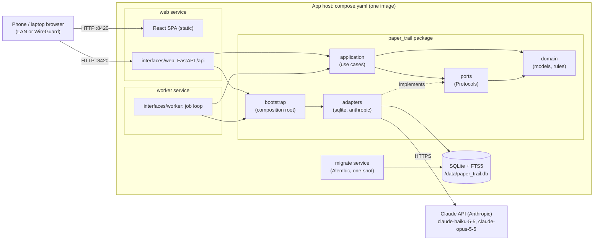
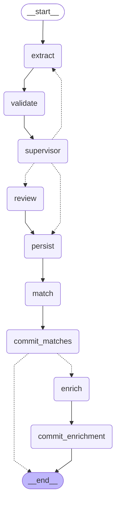
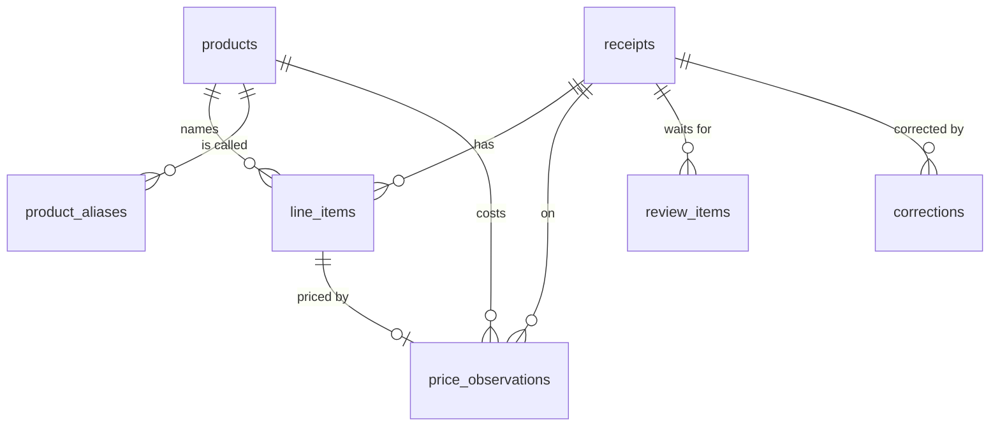

# How it works

The architecture, what the agents do with each receipt, how lines are matched to products,
how new products are described, what ends up in the database, and the tools the agents
call. The commands that drive all of this from a terminal are in [the CLI guide](cli.md).

## Architecture

Hexagonal (ports and adapters): the domain and use cases know nothing about SQLite, Claude,
FastAPI or LangGraph. Every external dependency sits behind a small `Protocol` (a port) with one
adapter, and tests swap in in-memory fakes. The layering is enforced by import-linter in
`make lint`.



- **web** serves the JSON API under `/api` and the built single-page app from the same origin
  (no CORS). **worker** runs the receipt pipeline. **migrate** applies database migrations once
  before either starts. All three run the same image as a non-root user with a read-only root
  filesystem.
- The single-page app is React 19, Vite, TanStack Router and Query, and Tailwind; it is built
  into the image and served by `web` (ADR-0014).
- The queue is a `jobs` table in the same database (ADR-0005). An upload, a review answer or a
  Try again queues a job; the web process never runs the graph. The worker takes one job at a
  time under a lease it renews by heartbeat, and the graph saves a checkpoint after every node,
  so a receipt continues from where it stopped. On `make down` or a redeploy the worker lets the
  running step finish (`PAPER_TRAIL_WORKER__SHUTDOWN_GRACE_S`, 90 s, enough for one Claude read;
  compose waits 100 s before killing it). If the worker dies mid-job, the job is taken again
  once its lease expires and counts an attempt; a job that used up its attempts (2) is not run
  again: it and its receipt are marked failed ("stopped unexpectedly"), and Try again picks it
  up from its checkpoint.
- One SQLite file holds everything (relational data, full-text index, agent checkpoints,
  the job queue, the Claude spend).
- The TypeScript API client is generated from the backend's OpenAPI document
  (`make api-client`), so the contract is defined once, in Python.

Design decisions are recorded as ADRs in [`docs/adr`](adr/); the staged plan is in
[`docs/PLAN.md`](PLAN.md).

## Processing a receipt

The agents run in the `worker` for photos sent from the phone, and in the `cli` service for
`make process` (see [Processing receipts with the agents](cli.md#processing-receipts-with-the-agents)).

The graph, as `make graph` prints it:



`extract` sends the photo (upright, long edge at most 2576 px, JPEG) to Claude with the
`extraction/v3` prompt and a structured-output schema: the receipt, every purchased item with
its printed text, code, department, quantity, unit, unit price, regular price, discount and
price paid, and the adjustments (deposits, fees, discounts on the whole order). Claude only
transcribes: it copies every price as printed, as text, and never adjusts a value to make the
totals match; Python converts and adds them up (ADR-0017). Card numbers in the answer are masked
before it is kept anywhere. `validate` checks in code that each item's regular price minus its
discount is its price paid, that a weighed item's quantity times its unit price matches its
regular or its paid price (within 1 cent), that the prices paid plus the adjustments make the
subtotal, and the subtotal plus the taxes the total; and that the store and date are known. The
`supervisor` saves a valid receipt (`persist`); otherwise it has the retry model
(`PAPER_TRAIL_CLAUDE__RETRY_MODEL`) read the photo again with the failures listed
(`PAPER_TRAIL_GRAPH__MAX_ATTEMPTS`, default 2), then sends the receipt to a person (`review`).
Each item is stored as an item line, followed by a discount line linked to it when it had a
discount, so the price history shows its regular price, its discount and what was paid. Then
`match` finds each line's product and `commit_matches` (the supervisor) links them, with a
price observation per line, and completes the receipt. Finally `enrich` lists the products this
receipt created and `commit_enrichment` describes them: from the catalog entry that named them
(the PLU table), then the product databases for a barcode, else Claude's guess (see
[Product lookups and guesses](#product-lookups-and-guesses)); nothing there can fail the
receipt, which is already complete (`PAPER_TRAIL_GRAPH__ENRICHMENT=false` skips both). The terminal
shows one block per receipt: every tool call, Claude read and routing decision, with times; the
same trace, with each read's model, tokens, stop reason and the photo's SHA-256 (never the
photo), is written to `/data/runs/<run>/traces/receipt-<id>-<UTC time>.json`, and a batch
summary to `/data/runs/<run>/summary.json`.

## Photos sent from the phone

A photo sent from the app (or `POST /api/receipts`) is stored, its receipt is created
`processing` and queued, and the `worker` reads it exactly as `process` does (same budget, retry
and review), one receipt at a time. When Claude cannot read it (no key, the API down, the budget
reached) the receipt is `failed` with its checkpoint and a reason, and is not retried on its
own: Try again in the app (`POST /api/receipts/{id}/retry`) or
`make pt ARGS="process --resume ID"` continues it. How the worker recovers from a crash is under
[Architecture](#architecture).

## Matching products

Every ITEM line is matched to a product within its store, and no model is asked (ADR-0018). A
line with a product code (a barcode, a PLU, or a store's own item number such as Costco's; the
code Claude read on the line, never one parsed out of its text) is identified by that code:

1. the code already names one of our products (`catalog`; `product_codes`);
2. a person's correction for that text at that store (`memory`), which also teaches the code;
3. a reference source knows the code (the PLU table, `<data_dir>/catalog/plu.csv`): a new
   product named by it (`new`, the name's source `plu`);
4. else a new product named by the printed text without its code and tax flags (`new`,
   `receipt_text`).

A line without a code is matched by a person's correction (`memory`), then an exact alias at
that store (`alias`), else it is a new product named by its printed text. An alias of another
store, or a global one, never links a line, so products are not linked across stores by their
text; a shared barcode or PLU is the same product at every store, while a store's own codes
belong to that store. Linking products across stores (comparison groups) is planned, not built.
`PAPER_TRAIL_CATALOG__ENABLED=false` (or `process --no-catalog`) matches coded lines by their
text instead, still without a model. Products created that way get no code, so with the catalog
on again the same line is not found by its code and makes a second product. Deposit, fee and
discount lines, and generic texts such as
`PRODUCE`, are never matched, and neither is a line a person named a product for when resolving
a review. A NOTE per receipt counts the sources (`catalog 9 (store 5, gtin 3, plu 1) · alias 1 ·
new 4 (printed text 3, plu 1)`), and each line's source is stored in
`line_items.match_source`. A product created from a source entry is then described from that
entry (`describe_from_catalog`: PLU name, category `produce`, tag `organic`); every product
field records its source (`products.field_sources`), a person's value is never overwritten, and
a category a person gave the same line at the same store (a `category` correction) wins.

How to correct a match, pause and resume a receipt, or read a photo again is in
[Corrections and resuming](cli.md#corrections-and-resuming).

## Product lookups and guesses

Each product a receipt creates is described, field by field, from the first source that knows
it (claude-extraction plan D3, D4):

1. the PLU table (stamped `plu`), or another product a person or a database named under the
   same code; never the product itself or one only printed or guessed;
2. for a barcode (GTIN), the open product databases: [Open Food Facts](https://world.openfoodfacts.org),
   then [Open Beauty Facts](https://world.openbeautyfacts.org) and
   [Open Products Facts](https://world.openproductsfacts.org) (stamped `off`), and UPCitemdb last
   when it is on (stamped `upc`). They give the name, brand and size; the next one is asked only
   while one of those is missing;
3. Claude's guess (the extract model, `PAPER_TRAIL_CLAUDE__EXTRACT_MODEL`, counted in the monthly
   budget), when the name or the category is still open: name, brand, size, category and tags,
   stamped `llm`. Claude is told the printed text, the store, the department heading, the code
   and an Open*Facts answer, never a price, a date or a UPCitemdb answer.

A database's answer counts as confirmed; a guess does not, so it shows in `catalog todo` (as
`suggested`) until you `catalog confirm` it, fix it with `catalog add` or `items correct`, or a
database answers on a later run. Only a field that is empty, printed (`receipt_text`) or guessed
(`llm`) is ever written: a person's, a database's or a legacy model's value is kept, and a
category read from a printed department heading is never replaced by a guess. A product is
guessed once.

**Only the barcode is sent** to the databases: no store, receipt, price or date. The requests
carry a generic User-Agent (`PaperTrail/1.0 (personal receipt app; +https://github.com/fabioo2/paper-trail)`),
go out one at a time, at most one every 4 s per Open*Facts database and one every 10 s and 100 a
UTC day to UPCitemdb. Answers are kept in the `product_lookups` table: a hit for good, a "not
found" for 30 days; an error or a rate limit is never kept, so the next run asks again.
costco.ca is never contacted. Every request happens outside a database write, and each product
is written in its own transaction, so a crash leaves the products already done described and
the next run (or `process --resume`) finishes the rest without asking again.

- `PAPER_TRAIL_LOOKUP__OPEN_FACTS` (default `true`): ask the three Open*Facts databases.
- `PAPER_TRAIL_LOOKUP__UPCITEMDB` (default **`false`**): ask UPCitemdb's free trial endpoint
  (no key, 100 requests a day). It is off because its terms do not clearly allow keeping its
  answers; read them before turning it on. Its answers are never sent to Claude.
- `PAPER_TRAIL_LOOKUP__TIMEOUT_S` (default `10`, at most `60`): per request.

Open Food Facts, Open Beauty Facts and Open Products Facts data is © their contributors and
available under the [Open Database License (ODbL)](https://opendatacommons.org/licenses/odbl/1-0/);
the fields Paper Trail keeps from them are stamped `off`.

Products stored before lookups existed are described by `catalog enrich` (a dry run that lists
each product, its open fields and the steps that may fill them; `--apply` does it and prints
`looked up N, guessed M, unchanged K, failed F`). Back up the database before the first
`--apply`.

## What gets saved: a product and its price history

Every purchase line ends up linked to one product, and every product keeps one price
observation per time it was bought, so the price history of anything is one query away. An
example (the prices are made up), gold kiwis bought at Costco on two receipts (three lines):

```json
{
  "product": {
    "id": 24,
    "canonical_name": "GOLD KIWI",
    "brand": null,
    "size_value": null,
    "size_unit": null,
    "category": null,
    "tags": [],
    "field_sources": { "canonical_name": "receipt_text" },
    "codes": [{ "scheme": "store", "store_key": "costco", "code": "3139415", "source": "receipt" }]
  },
  "price_history": [
    {
      "observed_on": "2026-09-24", "store_name": "Costco Wholesale", "receipt_id": 4,
      "line_item_id": 53, "raw_text": "3139415 GOLD KIWI", "match_source": "catalog",
      "quantity": "1", "unit_price_cents": 1499, "line_total_cents": 1499, "currency": "CAD",
      "discount_cents": -300, "unit_discount_cents": -300, "paid_cents": 1199, "on_sale": true
    },
    {
      "observed_on": "2026-11-05", "store_name": "Costco Wholesale", "receipt_id": 2,
      "line_item_id": 34, "raw_text": "3139415 GOLD KIWI", "match_source": "new",
      "quantity": "1", "unit_price_cents": 1499, "line_total_cents": 1499, "currency": "CAD",
      "discount_cents": -300, "unit_discount_cents": -300, "paid_cents": 1199, "on_sale": true
    },
    {
      "observed_on": "2026-11-05", "store_name": "Costco Wholesale", "receipt_id": 2,
      "line_item_id": 36, "raw_text": "3139415 GOLD KIWI", "match_source": "new",
      "quantity": "1", "unit_price_cents": 1499, "line_total_cents": 1499, "currency": "CAD",
      "discount_cents": -300, "unit_discount_cents": -300, "paid_cents": 1199, "on_sale": true
    }
  ]
}
```

The other receipt's line was linked by the code the first one attached (`match_source`
`catalog`), without a model call; nothing named the product but its printed text, so it keeps
that name and no category until a person or a data source names it. Each of these lines was followed by a `-3.00` instant-savings line naming
the kiwi's code (`0000399102 / 3139415`), stored as its own `discount` line and linked to the
item above it with that code: the regular 14.99 is the price history; 11.99 is what was paid. A
discount that cannot be tied to one item (`0000398549 / MULTIPLE`, or a line without a code)
stays on the receipt, never guessed or prorated. A discount larger than the nearest free item
with its code stays on the receipt too, unless a later discount with the same code takes that
item: then it links to an earlier, larger item with the code, or, with none, is reported as
having no item (`no_item`). The upgrade that adds discounts (migration 0004) refuses to run
while any price observation has a negative line total, and lists their ids; find them with
`SELECT id FROM price_observations WHERE line_total_cents < 0`, delete or correct them, and
upgrade again. Receipts stored before discounts were linked are brought up to date with
`paper-trail prices backfill` (a dry run; `--apply` writes, and `--run NAME` and `--receipt ID`
narrow it). It looks at completed receipts only: one that was still being processed when the
upgrade ran (saved, not yet matched) gets its prices at discount 0 when it completes, so run the
backfill once more after it has. If a receipt fails, the command stops with exit status 1 naming
it; the receipts before it stay applied and running it again finishes the rest. The tables
behind it:



- `receipts`: store, date, subtotal, tax, total (integer cents), status (with the reason when
  it failed) and the stored photo (receipts read before Claude also keep their masked OCR text).
- `line_items`: each line in order (an item, then its discount when it had one, then the
  adjustments): raw text, kind (`item`, `discount`, `deposit`,
  `fee`), quantity and its unit (`each`, `kg`, `lb`, ...), unit price, line total, and the product it was matched to, with how
  (`memory`, `catalog`, `alias`, `new`; `vector` and `llm` only on lines matched before product
  codes); a `discount` line's `applies_to_position` names the
  item line it reduces.
- `products`: name, brand, size, category and tags, each with its source in `field_sources`
  (`receipt_text`, `person`, `plu`, `legacy_model` for values a model wrote before 0006); its
  names are in `product_aliases`.
- `product_codes`: the codes that name a product: a barcode or PLU at every store, a store's own
  code at that store, with who attached it (`receipt`, `plu`, `correction`, ...). A person's
  mapping replaces another product's; a machine's never does.
- `price_observations`: one row per purchased item line on a dated receipt: product, receipt,
  line, store, date, quantity, the regular unit price and total, and the discount applied to the
  line (per line and per unit), what was paid and whether it was on sale. The regular prices are
  the price history; the paid amounts are the spending. Discounts that cannot be tied to one item
  (`MULTIPLE`) stay on the receipt, so what was spent on items is the paid amounts plus those.
  A negative item line (a return on a receipt a person forced through review) gets no row; the
  trace notes it.
- `corrections` (a person's fixes, the long-term memory matching reads first), `review_items`
  and `jobs`.

The product page in the app shows this history (`GET /api/products/{id}/purchases`); with SQL
it reads:

```sql
SELECT o.observed_on, r.store_name, o.quantity, o.unit_price_cents, o.line_total_cents,
       o.paid_cents, o.on_sale
FROM price_observations o JOIN receipts r ON r.id = o.receipt_id
WHERE o.product_id = 24 ORDER BY o.observed_on;
```

## Tools, allowlists and MCP

Agents never touch the database: every read or write is a tool call checked against the
calling agent's role (only the supervisor's tools write). The same tools can be listed and
called from the command line, in-process or through the MCP server:

```sh
make pt ARGS="tools list"                          # every role and the tools it may call
make pt ARGS="tools list --role matching"
make pt ARGS="tools call --role validation check_arithmetic '{\"receipt\": {...}}'"
make pt ARGS="tools call --role matching save_receipt '{\"receipt_id\": 1, \"draft\": {}}'"
make mcp-up                                        # the MCP server on 127.0.0.1:8421
make pt ARGS="tools list --role matching --transport mcp"
make mcp-down
make process RUN_NAME=e3-mcp ARGS="--transport mcp"
```

- `tools call` prints the result as JSON and exits 0; it exits 5 when the role may not call the
  tool (`denied: role=matching tool=save_receipt`, also logged as `tool.denied`), 2 for a usage
  error (payload not a JSON object, unknown tool, input the tool refuses), and 1 when the
  database is not migrated, the MCP server is unreachable or the tool itself failed.
- `make mcp-up` serves one MCP endpoint per role at `http://127.0.0.1:8421/mcp/<role>/`
  (streamable HTTP) over the main database; `tools --transport mcp` talks to it through
  `PAPER_TRAIL_MCP__URL` (default `http://mcp:8000`, the service inside compose). It has no
  authentication and its supervisor tools write, so it is published on loopback only and
  answers only the Host names `127.0.0.1`, `localhost` and `mcp`.
- `process --transport mcp` (or `PAPER_TRAIL_TOOLS__TRANSPORT=mcp`) calls the tools over MCP
  too, but serves its run's own tools on a loopback port inside the command (a standalone
  server would write to the main database, not the run's), so it needs no `make mcp-up`. The
  outcome and the trace are the same as in-process; only the times differ.
